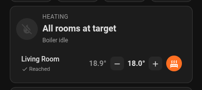
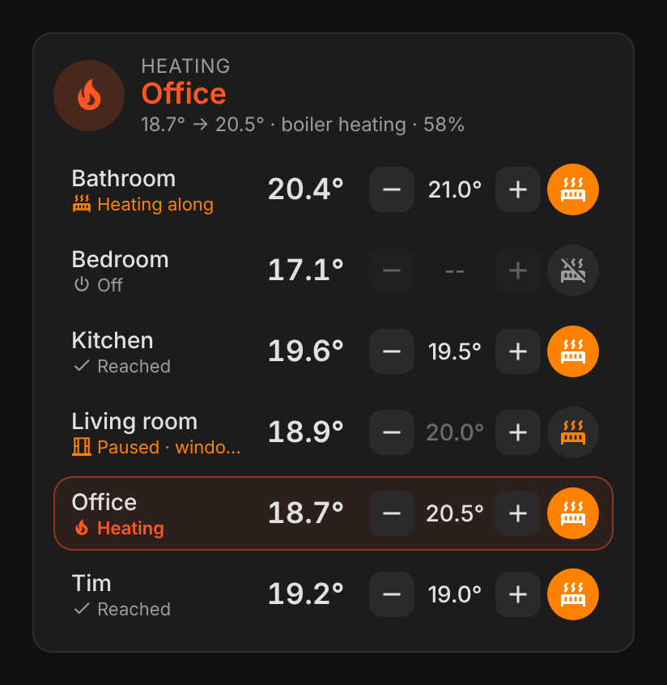
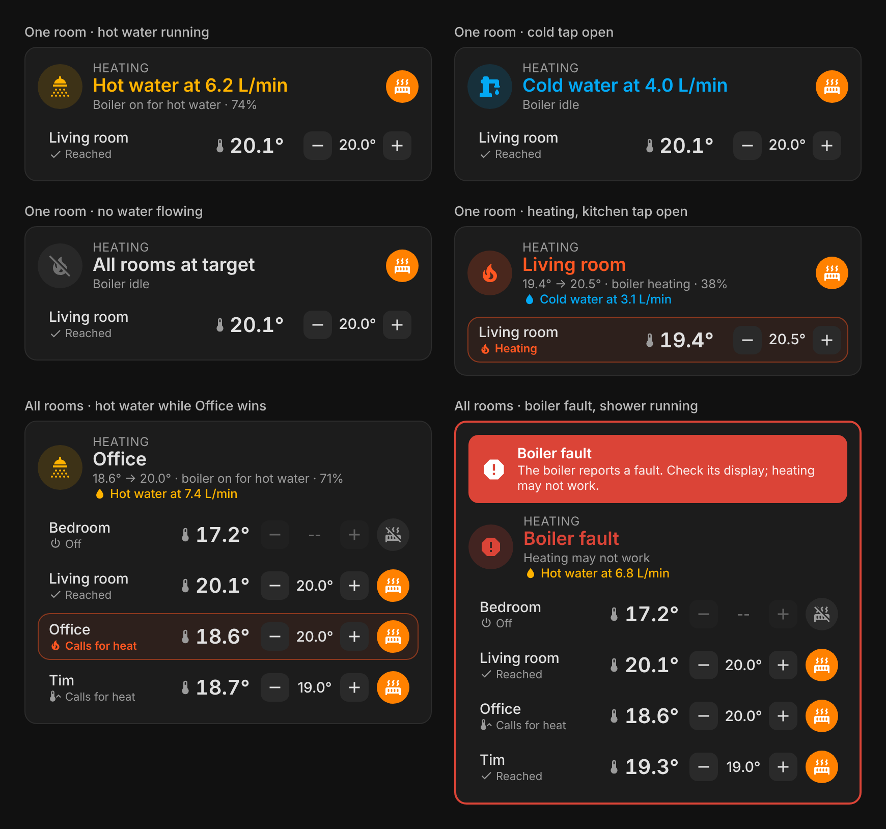
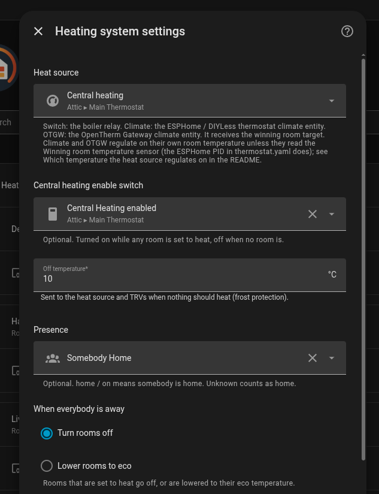
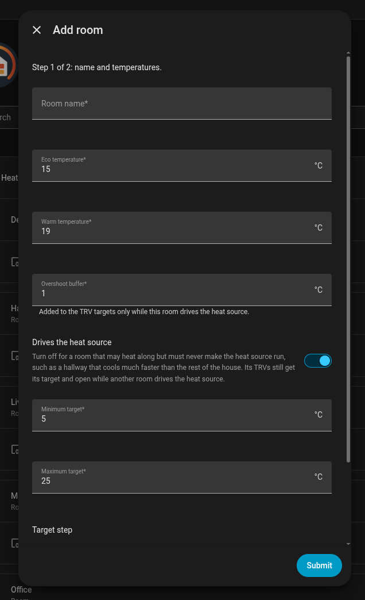
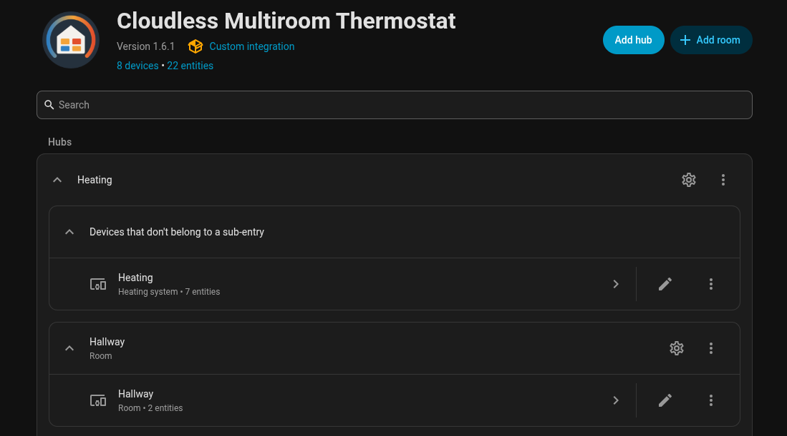

  
  
  
  

# Cloudless Multiroom Thermostat

A Home Assistant integration for multi-room central heating without a cloud. Any number of rooms, each with its own temperature sensor and radiator valves, share one heat source: the room that needs heat most drives the boiler, and every other room heats along through its own valves. Everything is set up from the UI and runs locally.

Other integrations put a smart controller on the boiler. This one puts a [virtual thermostat in every room](#a-virtual-thermostat-in-every-room) and lets the boiler serve them. The one requirement is an OpenTherm controller you run yourself, such as a DIYLess or a generic OpenTherm module with an ESP32: a few euros, two wires to the boiler, and ESPHome. In return each room gets its own control, the integration learns from how your house actually heats instead of a calibration run, and it is built for houses that heat several rooms independently.

- **No cloud:** Home Assistant, your TRVs and your boiler thermostat, nothing else.
- **Any number of rooms**, each with its own target, presets and window sensors.
- **One heat source**, as an on/off relay, an OpenTherm thermostat (ESPHome, DIYLess) or an OpenTherm Gateway. Full multi-room control needs a relay or an OpenTherm controller without its own room sensor, see [A virtual thermostat in every room](#a-virtual-thermostat-in-every-room).
- **Presence aware:** rooms go off or to eco when everybody is away, and come back when someone is home.
- **Open window detection** per room.

## Why this exists

I have been using Home Assistant for several years. One of the main reasons is automating my house with little or no cloud dependency. Over the years, some cloud dependencies still crept in quietly: Home Connect, SmartThings and Tado. Then Tado, and later SmartThings, announced changes to their business model that make users pay for connectivity.

When Tado did, more than a year ago, I started building a local heating system I had full control over. The hardware turned out to be the easy part. On the Home Assistant forum I found [a post by Dujith](https://community.home-assistant.io/t/opentherm-multi-room-brainstorming-ideas/337784) with a Home Assistant template holding a basic version of what is now one of the core principles: the two tier system. Kudos to him! I extended the template, added automations and ended up with a pretty good basic system, which heated my house for a full season before it became this integration. Having full control gave me insights and ideas, and opened the door to a much more efficient heating system.

Things really took off when I started using Claude Code for the programming, a skill I lack. That is how development works today: I design, review, monitor and make sure we are heading in the right direction. Claude Code writes the code.

Where it is going next: [ROADMAP.md](ROADMAP.md).

## Dashboard: Heating Control Card

The integration comes with its own dashboard card, **Heating Control Card**: no separate install. It shows every room with its temperature, target, Heat/Off and role, highlights the room the boiler heats for, and shows the boiler state: heating, pumping or hot water, modulation, faults and pressure warnings.

 

Add a card of type `custom:heating-control-card` to a dashboard; it finds the rooms by itself. The integration adds the card to your dashboard resources at startup (reload the browser once). Options, YAML-mode dashboards and moving over from the separately installed card: **[docs/card.md](docs/card.md)**.

## Contents

- [Why this exists](#why-this-exists)
- [Dashboard: Heating Control Card](#dashboard-heating-control-card)
- [Install](#install)
- [Set up](#set-up)
- [What it creates](#what-it-creates)
- [How it works](#how-it-works)
  - [A virtual thermostat in every room](#a-virtual-thermostat-in-every-room)
- [Learning features (observe only)](#learning-features-observe-only)
- [Example setup](#example-setup)
- [ESPHome OpenTherm thermostat (`thermostat.yaml`)](#esphome-opentherm-thermostat-thermostatyaml)
- [Boiler specific notes](#boiler-specific-notes)
- [Coming in v2.0.0](#coming-in-v200)
- [Development and test environment](#development-and-test-environment)

## Install

Requires Home Assistant 2026.10 or newer.

Search for **Cloudless Multiroom Thermostat** in the Marketplace (Home Assistant 2026.11 and newer) or HACS, install it and restart Home Assistant. Then **Settings > Devices & services > Add integration > Cloudless Multiroom Thermostat**. The dashboard card comes with it.

Not found? The catalog listing is still in review. Use the button, or add the repository by hand as below.

The first button opens the repository in your Home Assistant (the Marketplace on 2026.11 and newer, HACS on 2026.10), ready to install. After installing, the second button starts the setup. Or add it as a custom repository:

**Home Assistant 2026.11 and newer (Marketplace):**

1. **Settings > Marketplace > Add from link**, enter `BarBaar44/Cloudless-Multiroom-Thermostat` and select **Add**. The Marketplace may ask you to connect GitHub first.
2. Open **Cloudless Multiroom Thermostat**, select **Install** and confirm. Restart Home Assistant if the Marketplace asks for it.
3. **Settings > Devices & services > Add integration > Cloudless Multiroom Thermostat**, if the setup didn't open by itself.

Updates appear under **Settings > Updates**. After installing one, restart Home Assistant. An install from HACS moves to the Marketplace by itself when you update Home Assistant to 2026.11, with the same entities.

**Home Assistant 2026.10 (HACS):**

1. In HACS: **⋮ > Custom repositories**, add `https://github.com/BarBaar44/Cloudless-Multiroom-Thermostat` with type **Integration**.
2. Install **Cloudless Multiroom Thermostat** and restart Home Assistant.
3. **Settings > Devices & services > Add integration > Cloudless Multiroom Thermostat**, or use the second button above.

## Set up

**The heating system** (one per heat source):

1. A name and the **heat source type**:
   - **On/off switch**: a relay boiler. It turns on when a room is the hysteresis (default 0.3 °C) below its target and off when every room reached its target.
   - **Climate entity**: an ESPHome or DIYLess OpenTherm thermostat, or any thermostat with a setpoint. It receives the target of the room that needs heat most.
   - **OpenTherm Gateway (OTGW)**: the OTGW climate entity, which receives that same target.

   **Which temperature the heat source regulates on** (background: [A virtual thermostat in every room](#a-virtual-thermostat-in-every-room)). The Climate and OTGW heat sources only receive the winning room's *target*. For real multi-room control the thermostat must also regulate on the winning room's *temperature*, the integration's **Winning room temperature** sensor. The ESPHome PID in [`thermostat.yaml`](#esphome-opentherm-thermostat-thermostatyaml) does. A thermostat that regulates on its own built-in sensor, and an OTGW (which regulates on the room temperature of the thermostat connected to it), compares the winner's target with the temperature where *it* hangs: it stops when that spot is warm, whichever room won, and keeps heating when that spot is cold although every room reached its target. The On/off switch has no such limit: the integration itself decides on and off from the room temperatures.
2. The heat source entity and, optionally, a **central heating enable** switch that is on while any room is set to heat.
3. Settings: the **off temperature** sent when nothing needs heat (default 10 °C), an optional **presence** entity with what happens when everybody is away (rooms off, or lowered to eco), and how often room temperatures are resent to TRV inputs.

**Rooms**: on the integration page, **Add room**, in two steps:

1. Name, eco and warm temperature, the overshoot buffer (default 1.0 °C), whether the room **drives the heat source** (default on, see [Rooms that only heat along](#rooms-that-only-heat-along)) and the target range and step.
2. The room temperature sensor, the TRVs (none is fine: the room then only adds heat demand), the TRVs' external temperature inputs (for example Sonoff TRVZB or Shelly BLU TRV), and window or door sensors with their open and close delays.

Add as many rooms as you like; the gear next to a room edits it. To put a room in an area, set the area on the room's device page. Settings of the heating system itself are under the gear next to it.

Scheduling is left to you: an automation or a scheduler card that sets presets or temperatures on the room climates.

## What it creates

- **A climate entity per room**: Heat/Off, target temperature, presets **Eco** and **Warm** (setting a temperature yourself switches to **Manual**). Attributes show its role (`winner`, `passenger`, `calls_for_heat`, `waiting`, `reached`, `paused`, `off`) and why it is paused. Mode, preset and target survive a restart.
- **Winning room**: the room driving the heat source, or Off, with its target, temperature and gap as attributes.
- **Winning room temperature**: that room's temperature, for a firmware PID that needs it as its process value (see [`thermostat.yaml`](#esphome-opentherm-thermostat-thermostatyaml)).
- Per room: **Paused** (window, away or manual, with the reason) and, with window sensors, a debounced **Window** sensor.
- **Delta temperature (legacy)**: disabled by default; the winner as one JSON state (`area`, `target`, `curr`, `delta`) for dashboards that expect that format.
- Services: `pause_room` and `resume_room` (hold a room off and release it), `set_all_off`.

## How it works

### A virtual thermostat in every room

A traditional setup has one physical thermostat in one room. Its built-in sensor decides when the boiler runs, so the whole house heats to what that one spot measures.

This integration turns that around. Every room gets its own **virtual thermostat** (a climate entity with its own sensor and target), and the boiler is driven by a controller that has **no room sensor of its own**: it heats for whichever room needs it most, using that room's temperature. There is no physical room thermostat in charge anymore.

That is the way forward, and it decides which heat source gives you real multi-room control:

| Heat source | Who decides when the boiler runs | Multi-room |
|---|---|---|
| **On/off switch** (relay) | The integration, from the room temperatures | Full |
| **Climate entity** with an ESPHome or DIYLess PID fed the [Winning room temperature](#process-value) (like [`thermostat.yaml`](#esphome-opentherm-thermostat-thermostatyaml)) | The controller, on the winning room's temperature | Full |
| **Climate entity** of a thermostat with its own built-in sensor | That thermostat, on the temperature where it hangs | Target only |
| **OpenTherm Gateway** with a room thermostat connected | That room thermostat, on its own sensor | Target only |

With *target only*, the integration still runs every room's TRVs, but boiler demand follows the room where the physical thermostat hangs. If you have an OTGW or a smart room thermostat now, the recommended path is to replace the room thermostat with an OpenTherm controller (such as a DIYLess board running [`thermostat.yaml`](#esphome-opentherm-thermostat-thermostatyaml)) and let the virtual thermostats take over.

### Two tiers

A boiler has only **one** flow temperature, while every room wants its own. Two tiers solve that without any room coordination:

**Tier 1, the heat source:** of all rooms set to heat, the one with the biggest gap between target and temperature is the **winner**. Its target goes to the heat source; with an ESPHome PID thermostat the boiler then modulates its flow temperature to bring exactly that room to its target. When no room has a real gap, the heat source gets the off temperature.

**Tier 2, the valves:** every room's TRVs get the room's target and regulate their own valve. Home Assistant never commands valve positions: as long as the water arriving is warm enough for a room's own target, its TRVs stay open and the room heats along (a **passenger**). When a room reaches its target, its TRVs close by themselves. Rooms are held off with the off temperature, never with the TRV's own off mode: a TRV that is switched off (on the device or by another automation) ignores every setpoint, so it is put back to heat. Only a room that wants more than the current winner waits, until it becomes the winner itself, which happens as soon as its gap is the largest.

**The overshoot buffer (winner only):** the winning room's TRVs get their target plus the buffer (default 1 °C); passengers get their exact target. Two controllers watch the winning room at once: the boiler's PID, which eases off its modulation gradually, and that room's TRV. Without headroom the TRV starts closing while the boiler is still pushing hot water, a fight that wastes heat and can trip a low-flow fault. A passenger's TRV can't get into that fight, because the boiler isn't modulating for it. The buffer moves with the winner.

**Rooms that only heat along:** turn off **Drives the heat source** for a room that may be heated but must never make the heat source run, such as a hallway that cools much faster than the rest of the house and would otherwise keep winning. Such a room never becomes the winner, never starts an on/off heat source and doesn't turn on the central heating enable switch. Its TRVs still get its target, so it heats along as a passenger whenever another room drives the heat source. While nothing else needs heat, its role is `waiting`.

**One temperature per room:** the room sensor's reading is also pushed to the TRVs' external temperature inputs, with a heartbeat (some TRVs, like the Sonoff TRVZB, fall back to their own sensor after 2 hours without an update). A TRV's own sensor sits on the radiator and reads warm; this way the room climate, the winner choice and the TRV all work from the same number. TRV writes are skipped when nothing changed, to save batteries.

**Windows and presence:** an open window (after its open delay) holds its room off and sets its TRVs to the off temperature; when it closes, the room returns to its own mode and target. When everybody is away, rooms go off or to eco; they return when someone is home. Window has priority over a manual pause, which has priority over away.

## Learning features (observe only)

Optional features that learn how the house and boiler behave and, unless you opt in to applying the PID advice automatically, never change the heating: warm-up episodes with PID advice, a night cooldown model that predicts the morning, gas per degree-day with the hot water split off, and an evening report, kept in a sensor for a Markdown card, with a notification only when something happened (or a summary, or the whole report). Switch them on under **Configure > Enable learning features (observe only)**. What each one does, what it needs and how mature it is: **[docs/experimental.md](docs/experimental.md)**. Their alpha and beta labels are about these optional features only; the heating control itself (rooms, TRVs, heat source) does not depend on them.

## Example setup

The hardware this was built and tested on. None of it is required: any TRV and temperature sensor Home Assistant can see will do.

| Component | Choice | Why |
|---|---|---|
| Boiler | Atag E325ec (2015) | Supports OpenTherm out of the box |
| Thermostat | [DIYLess OpenTherm thermostat](https://diyless.com/product/opentherm-thermostat) with custom ESPHome ([`thermostat.yaml`](thermostat.yaml)) | Full local control over the PID loop and the OpenTherm bus |
| TRVs | [Sonoff TRVZB](https://sonoff.tech/en-nl/products/sonoff-zigbee-thermostatic-radiator-valve) and [Shelly BLU TRV](https://www.shelly.com/products/shelly-blu-trv-single-pack) | Sonoff where it fits; Shelly where space is tight |
| Room sensors | Xiaomi/Aqara [LYWSD03MMC](https://www.zigbee2mqtt.io/devices/LYWSD03MMC-z.html), reflashed with Zigbee firmware | Cheap, tiny, battery powered, on the same local Zigbee mesh as the TRVs |
| Radiator booster fans | Custom "DBE" ESPHome boards ([BarBaar44/ESPHome/DBE](https://github.com/BarBaar44/ESPHome/tree/main/DBE)) | Push air through the radiator fins to get more heat out of the same water temperature |

**TRVs compared:**

| | Sonoff TRVZB | Shelly BLU TRV |
|---|---|---|
| Size | Bulkier | Small, about the size of a Tado TRV |
| Cost | Cheaper | More expensive |
| Connectivity | Fully local via Zigbee2MQTT | Bluetooth, needs a BLU gateway |
| External temperature input | Yes | Yes |

Sonoff is the better choice where it fits: cheaper, fully local and well supported.

**Room sensors:** the LYWSD03MMC speaks Bluetooth with its stock firmware. Reflashed with Zigbee firmware ([instructions on the Zigbee2MQTT page](https://www.zigbee2mqtt.io/devices/LYWSD03MMC-z.html)) it joins the same Zigbee network as the TRVs, so no Bluetooth proxies are needed per room.

**Booster fans:** each radiator has a fan board that measures flow and return temperature and blows air across the fins while the radiator still gives off heat. They work independently of the integration: they make the heat a radiator receives reach the room faster, whichever room is the winner. Hardware files are in [BarBaar44/EasyEDA](https://github.com/BarBaar44/EasyEDA).

## ESPHome OpenTherm thermostat (`thermostat.yaml`)

[`thermostat.yaml`](thermostat.yaml) is the ESPHome config for the DIYLess OpenTherm thermostat, from `opentherm:` on. Use it with the **Climate entity** heat source: the integration sets the PID climate's target to the winner's target, and the firmware reads the winner's temperature as its process value.

- **`opentherm:`** OpenTherm master on GPIO 21 (in) and 22 (out), central heating enabled. The hot water enable flag is sent as off; this combi boiler still makes hot water on demand, at the setpoint set on its own panel.
- **`output:`** `t_set` is the boiler's target flow temperature on a fixed 0 to 100 °C range (`zero_means_zero`, so 0 means boiler off). The PID drives `ch_flow_request`, which writes its output times the flow limit to `t_set`. The limit is the **Central heating max flow temperature** number (default 40 °C), set from Home Assistant without reflashing. Don't rely on the boiler's panel maximum or `auto_max_value` instead: on the ATAG here `auto_max_value` left the range at 0 to 100, and the boiler followed requests up to its own bound of 50 °C with its panel maximum at 40. Point the learning features' **Boiler maximum flow temperature** field at this number.
- **`climate: platform: pid`** (`main_climate`, "Central heating") the control loop. Its room temperature comes from Home Assistant: point it at the integration's **Winning room temperature** sensor (the example uses `sensor.virtual_heating_temperature`; rename the sensor to that, or change the ID). A 1 second heartbeat filter keeps the PID fed when the value doesn't change. Starting values `kp: 1.75`, `ki: 0.0075`, for a flow limit of 40. The PID output is a fraction of the limit, so changing the limit changes how hard the same Kp and Ki heat: a lower limit heats more gently. To keep the response when you change the limit, scale Kp, Ki and Kd by old limit / new limit (40 to 50: 1.4 and 0.006).
- **`interval:` fail safe** after 5 minutes without a Home Assistant connection the room temperature is set to unknown, and the PID turns its output off (it does that when its sensor is NaN). Without it the heartbeat would keep feeding the PID the last value, so it would keep heating towards the last target. When Home Assistant connects again it sends the current value and the PID resumes. If your config already has an `interval:` block, add this entry to it.
- **`sensor`, `binary_sensor`, `switch`** the OpenTherm telemetry this boiler supports: modulation, pressure, flow, return and hot water temperatures, faults, flame, pump, and the central heating, hot water and outside temperature compensation switches.

**Runtime-adjustable PID values.** "Central heating Kp / Ki / Kd" are number entities that apply to `main_climate` on every change and at boot, so values set in Home Assistant survive a reboot. A changed starting value in the YAML doesn't replace a stored value, so after a flash set new values in Home Assistant. Coming from the 0 to 100 range (`auto_max_value`) with a limit of 40: multiply Kp, Ki and Kd by 2.5. "Central heating PID Result / Error / Proportional / Integral / Derivative" sensors show why the loop does what it does (ESPHome reports them x100). `min_integral: 0`: the loop only heats, so a negative integral is never useful and would otherwise have to unwind every morning. The [PID advice](docs/experimental.md#warm-up-episodes-and-pid-advice) works with these numbers.

See [Boiler specific notes](#boiler-specific-notes) before adding writes for your boiler.

## Boiler specific notes

Issues found with one boiler brand or model. They are not caused by the integration, but by what an OpenTherm thermostat sends to that boiler.

### Atag E325EC: never write the hot water setpoint (lockout C1 51)

Found on an **Atag E325EC** combi boiler (2015) over OpenTherm. Other Atag models may behave the same, but that has not been tested.

> **Do not let the thermostat write the hot water setpoint, OpenTherm ID 56.** On the Atag E325EC it locks the boiler out with **C1 51** (no heating and no hot water) until the writes stop. Reading ID 56 is fine. Set the hot water temperature on the boiler's own panel.

**What it looks like:** the display shows **C1 51**, which Atag fault lists describe as a fan fault. In Home Assistant "Fault indication" turns on, the flame stays off on every demand, and a reset clears it for only a few seconds. The fan itself is fine: with the thermostat disconnected the boiler works normally.

**C1 05 is not a fault:** after a power cycle or reset the display shows **C1 05** (or C0 05) for about 7 minutes. That is the automatic air removal program; the fault bit can stay on until it finishes.

**If C1 51 appears:**

1. Check what the thermostat *writes* to the boiler. The ESPHome log shows every message (`WRITE_DATA; id: ...`); with `web_server:` enabled it can be followed at `http://<thermostat-ip>/events`.
2. Disconnect the thermostat, reset the boiler and open a hot water tap. No fault means the boiler is fine and something the thermostat sends is the trigger; remove recently added writes first.
3. Only if C1 51 also returns with nothing connected is it the fan, its wiring or the control board: a job for the installer.

## Coming in v2.0.0

In design, not built yet. Plans can still change.

- **Schedules in the integration:** a week schedule per room, with switch points at 15 minute steps that set a preset. Heating follows it without a dashboard open, so no schedule automations are needed. Copy a day to other days or a week to other rooms, switch a room's schedule off, or suspend all schedules at once.
- **Your own presets:** Eco and Warm plus presets you add (Sleep, for example), each with its own temperature per room. Change what "warm" means in one place.
- **Manual changes that expire:** a target set by hand holds until the next switch point, for 1 or 3 hours, or until you go back to the schedule.
- **Sun assist:** on a sunny morning, rooms that get sun hold a lower temperature and only warm up if a light sensor still reads dark at a check time. Set up in the integration options.
- **Detailed learning reports:** trends of the learning features over weeks and winters in Home Assistant's long term statistics, history of warm-ups and nights on request, and a learning view in the Heating Control Card.
- **Heating Control Card:** schedule line and today strip per room, a whole house timeline, a week view, and editors for schedules, presets and overrides (drag on desktop, a list on a phone).

## Development and test environment

- [`dev/`](dev/README.md): a simulated house (rooms that warm up and cool down, TRVs, a thermostat with a PID like `thermostat.yaml`, a boiler that short cycles like a real one, gas meter and weather) to try everything without hardware, including the learning features, as a Docker container or a VM for Virtual Machine Manager, with a script that sets it all up through the real forms.
- `tests/`: tests on a real Home Assistant core (`pip install -r requirements_test.txt`, then `pytest`). CI also runs ruff, shellcheck, hassfest and the HACS validation.
- [CHANGELOG.md](CHANGELOG.md) lists what changed per release.
