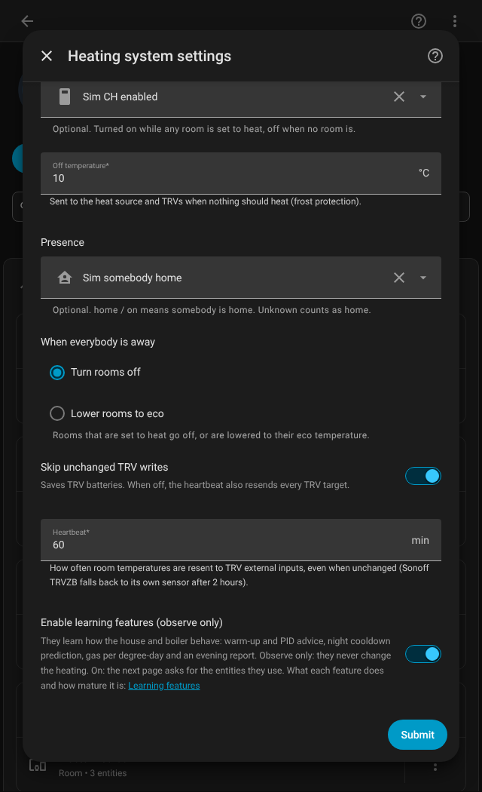
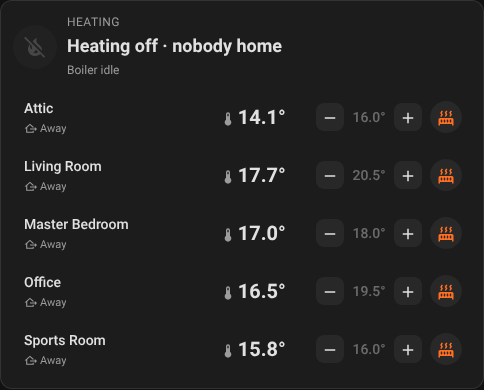

# Away

**In one sentence:** when everybody leaves, rooms that are set to heat go off or drop to their eco temperature, and they come back by themselves when someone is home.

## When you want it

When Home Assistant knows whether someone is home, for example through the Companion app on everyone's phone. Without a presence entity the house is always treated as occupied.

## How to turn it on

**Settings > Devices & services > Cloudless Multiroom Thermostat > Configure** on the heating system: pick a **Presence** entity and choose **When everybody is away**.

## Settings

| Setting | Default | What it does |
|---|---|---|
| Presence | none | Who is home. See below which entities work |
| When everybody is away | Turn rooms off | **Turn rooms off**: rooms set to heat are held off. **Lower rooms to eco**: rooms heat to their eco temperature (or their own target, if that is lower) |

**Which presence entities work:**

| Entity | Home | Away |
|---|---|---|
| `zone.home` | 1 or more persons in the zone | 0 |
| A person or device tracker | `home` | `not_home` or another zone |
| A binary sensor or input boolean (for example "Somebody home") | `on` | `off` |

When the presence entity is unavailable or unknown, the house counts as occupied, so a lost connection never leaves the house cold.

## What you see on the card

With **Turn rooms off**, rooms set to heat show **Away**, and the header says **Heating off · nobody home**. With **Lower rooms to eco**, they keep heating, to the lower temperature. Rooms that are Off stay Off either way, and every room returns to its own mode and target when someone is home.

The heating system's **Winning room** sensor has a `present` attribute; each room's **Paused** sensor says why it is paused.

## Common questions

**Does away overrule an open window?** No: an open window comes first, then a manual pause, then away.

**I have visitors Home Assistant doesn't track.** With an input boolean as the presence entity you can switch it on by hand. Otherwise pick **Lower rooms to eco** so the house doesn't go cold. A guest mode is planned for v2.0, see the [roadmap](../ROADMAP.md).

**Does it change my presets or targets?** No. Away only changes what is sent to the heat source and the TRVs while nobody is home.
