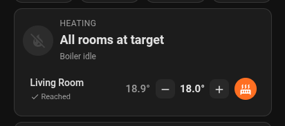

# Heating Control Card

The dashboard card for Cloudless Multiroom Thermostat. It ships with the integration: no separate install.

<p align="center"></p>

It shows every room with its temperature, target, Heat/Off and role, highlights the room the boiler heats for, and shows the boiler state: heating, pumping or hot water, modulation, faults and pressure warnings.

The card writes only to the room climates, the single source of truth per room. Everything downstream (TRVs, the overshoot buffer for the winner, the boiler setpoint) is the integration's job, exactly as with any other change to a room. The rooms tell the card which one is the winner, each room's role and why a room is paused, so no extra sensor is needed.

## How it gets on your dashboard

The integration serves the card at `/cloudless_multiroom_thermostat/heating-control-card.js` and adds it to your dashboard resources when Home Assistant starts, with the integration version in the URL so your browser loads the new card after an update. Reload the browser once after installing or updating.

**Dashboards in YAML mode** (`resource_mode: yaml`) can't be changed by an integration. Add the resource yourself; the log shows the exact URL:

```yaml
lovelace:
  resources:
    - url: /cloudless_multiroom_thermostat/heating-control-card.js
      type: module
```

**Had the separate Heating Control Card installed?** Remove it in HACS or the Marketplace, and remove its entry under **Settings > Dashboards > ⋮ > Resources** if it is still there. Your dashboards keep working: the card type stays `custom:heating-control-card`. The log warns while both copies are installed.

When you remove the last heating system, the integration removes its resource again.

## Use

```yaml
type: custom:heating-control-card
```

That shows every room, sorted by name. To pick and order rooms, or rename one:

```yaml
type: custom:heating-control-card
thermostats:
  - climate.living_room
  - climate.office
  - entity: climate.room_tim
    name: Tim
```

With a list, the header still speaks for the whole house: a card that shows only the living room says the boiler is heating for the bedroom when the bedroom wins.

All options are optional:

| Option | Default |
|---|---|
| `title` | `Heating` |
| `thermostats` | every room of the integration, sorted by name. A list of entities, or objects with `entity`, `name`, `step`, `on_mode` |
| `show_off` | `true`. With `false`, rooms that are off are hidden |
| `boiler` | `binary_sensor.main_thermostat_central_heating_active` |
| `hot_water` | `binary_sensor.main_thermostat_domestic_hot_water_active` |
| `flame` | `binary_sensor.diyless_thermostat_flame_on` |
| `modulation` | `sensor.thermostat_relative_modulation_level`, shown while the burner fires |
| `ch_enabled` | `switch.main_thermostat_central_heating_enabled` |
| `fault` | `binary_sensor.main_thermostat_fault_indication` |
| `pressure` | `sensor.thermostat_water_pressure_in_ch_circuit` |
| `water_flow` | none. A sensor in L/min, e.g. `sensor.watermeterkit_water_meter_kit_current_usage` |
| `pressure_min` | `1.4` (bar) |
| `pressure_max` | `2.7` (bar) |
| `step` | each room's `target_temp_step`, else `0.5` |
| `on_mode` | `heat` |
| `colors` | see below |

The boiler entity defaults are the names of an ESPHome OpenTherm thermostat ([`thermostat.yaml`](../thermostat.yaml)); point them at your own. Set any entity option to `null` to switch that part off. The card also has a visual editor in the dashboard UI.

The YAML setup from before the integration (`climate.virtual_thermostat_*`, `sensor.delta_temperature`, `heating_area`, a room's `paused` entity, the 0.2 `climate:` key) is no longer supported. The card ignores those keys and logs a warning in the browser console.

### Colors

Each key takes any CSS color (`"#ff9800"`, `orange`, `var(--orange-color)`) or `[r, g, b]`. Leave a key out to keep its default. The visual editor has them under **Colors**.

```yaml
type: custom:heating-control-card
colors:
  hot_water: "#ffb300"
  pumping: teal
```

| Key | Used for | Default |
|---|---|---|
| `heating` | flame icon, header text and winning row while the burner fires | `#ff5722` |
| `hot_water` | shower head during a hot water run | `var(--amber-color)` |
| `pumping` | pump icon | `var(--disabled-color)` |
| `idle` | icon when the boiler is idle | `var(--disabled-color)` |
| `offline` | icon when the thermostat is offline | `var(--disabled-color)` |
| `fault` | fault banner, border and header | `var(--error-color)` |
| `warning` | pressure icon and warning line | `var(--error-color)` |
| `room` | Heat buttons, Heating along, Paused, pending targets | `var(--state-climate-heat-color)` |
| `water` | water flow text and line | `var(--light-blue-color)` |

## Development

The card is one file without a build step: [`custom_components/cloudless_multiroom_thermostat/www/heating-control-card.js`](../custom_components/cloudless_multiroom_thermostat/www/heating-control-card.js). Its tests run in jsdom: `cd frontend && npm install && npm test`. CI runs them on every change.
