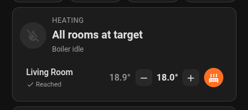
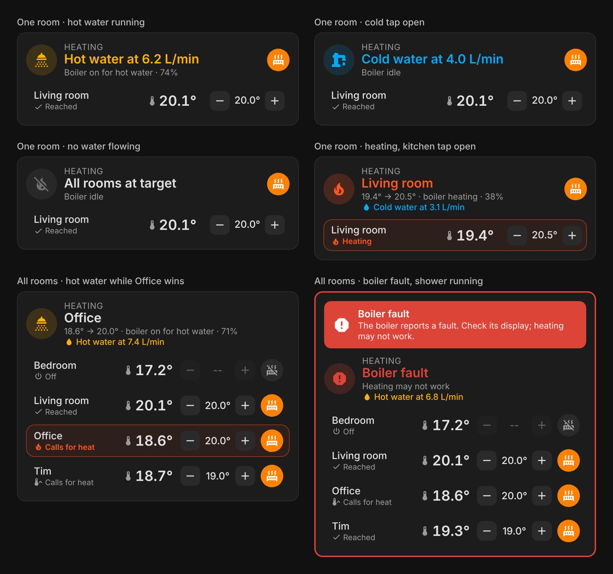
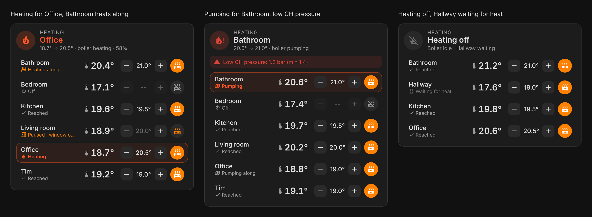
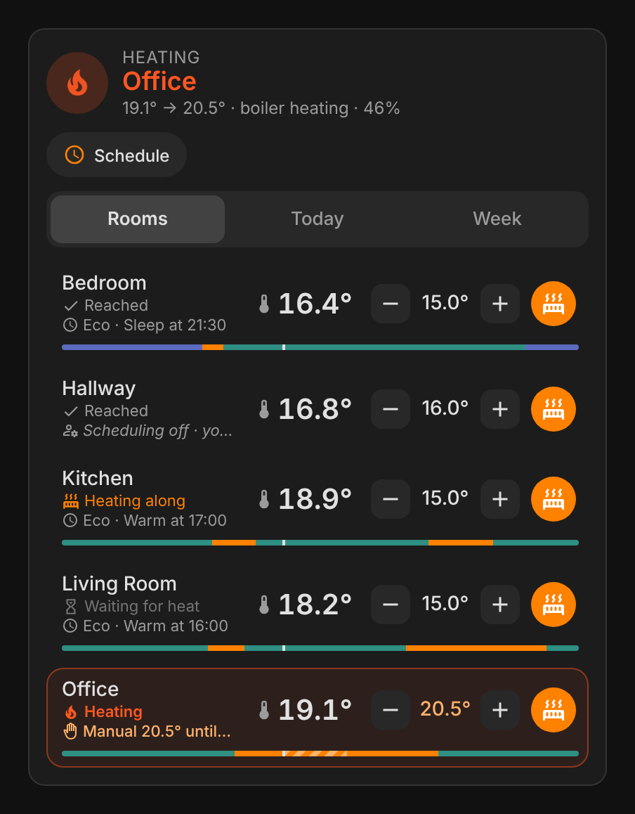
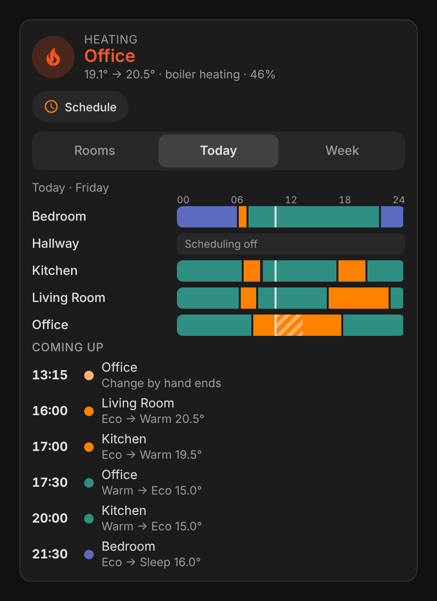
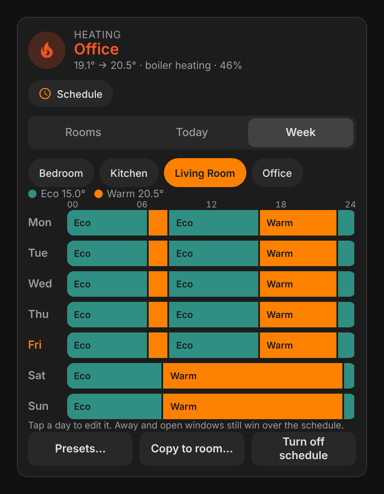

# Heating Control Card

**In one sentence:** a dashboard card that shows every room and what the boiler is doing, and lets you set rooms to Heat or Off and change their targets.

<p align="center"></p>

## When you want it

On any dashboard where you want to see or change the heating. It ships with the integration: no separate install.

## How to turn it on

Reload the browser once after installing or updating the integration, then add a card of type `custom:heating-control-card` to a dashboard. It finds the rooms by itself. The card also has a visual editor in the dashboard UI.

### How it gets on your dashboard

The integration serves the card at `/cloudless_multiroom_thermostat/heating-control-card.js` and adds it to your dashboard resources when Home Assistant starts, with the integration version in the URL so your browser loads the new card after an update. Reload the browser once after installing or updating.

**Dashboards in YAML mode** (`resource_mode: yaml`) can't be changed by an integration. Add the resource yourself; the log shows the exact URL:

```yaml
lovelace:
  resources:
    - url: /cloudless_multiroom_thermostat/heating-control-card.js
      type: module
```


**Had the separate Heating Control Card installed?** Remove it in the Marketplace, and remove its entry under **Settings > Dashboards > ⋮ > Resources** if it is still there. Your dashboards keep working: the card type stays `custom:heating-control-card`. The log warns while both copies are installed.

When you remove the last heating system, the integration removes its resource again.

## Settings

```yaml
type: custom:heating-control-card
```

That shows every room, sorted by name. To pick and order rooms, or rename one:

```yaml
type: custom:heating-control-card
thermostats:
  - climate.living_room
  - climate.office
  - entity: climate.room_tim
    name: Tim
```

With a list, the header still speaks for the whole house: a card that shows only the living room says the boiler is heating for the bedroom when the bedroom wins.

All options are optional:

| Option | Default |
|---|---|
| `title` | `Heating` |
| `thermostats` | every room of the integration, sorted by name. A list of entities, or objects with `entity`, `name`, `step`, `on_mode` |
| `show_off` | `true`. With `false`, rooms that are off are hidden |
| `boiler` | `binary_sensor.main_thermostat_central_heating_active` |
| `hot_water` | `binary_sensor.main_thermostat_domestic_hot_water_active` |
| `flame` | `binary_sensor.diyless_thermostat_flame_on` |
| `modulation` | `sensor.thermostat_relative_modulation_level`, shown while the burner fires |
| `ch_enabled` | `switch.main_thermostat_central_heating_enabled` |
| `fault` | `binary_sensor.main_thermostat_fault_indication` |
| `pressure` | `sensor.thermostat_water_pressure_in_ch_circuit` |
| `water_flow` | none. A sensor in L/min, e.g. `sensor.watermeterkit_water_meter_kit_current_usage` |
| `pressure_min` | `1.4` (bar) |
| `pressure_max` | `2.7` (bar) |
| `step` | each room's `target_temp_step`, else `0.5` |
| `on_mode` | `heat` |
| `colors` | see below |

The boiler entity defaults are the names of an ESPHome OpenTherm thermostat ([`thermostat.yaml`](../thermostat.yaml)); point them at your own. Set any entity option to `null` to switch that part off. The card also has a visual editor in the dashboard UI.

The YAML setup from before the integration (`climate.virtual_thermostat_*`, `sensor.delta_temperature`, `heating_area`, a room's `paused` entity, the 0.2 `climate:` key) is no longer supported. The card ignores those keys and logs a warning in the browser console.

### Colors

Each key takes any CSS color (`"#ff9800"`, `orange`, `var(--orange-color)`) or `[r, g, b]`. Leave a key out to keep its default. The visual editor has them under **Colors**.

```yaml
type: custom:heating-control-card
colors:
  hot_water: "#ffb300"
  pumping: teal
```

| Key | Used for | Default |
|---|---|---|
| `heating` | flame icon, header text and winning row while the burner fires | `#ff5722` |
| `hot_water` | shower head during a hot water run | `var(--amber-color)` |
| `pumping` | pump icon | `var(--disabled-color)` |
| `idle` | icon when the boiler is idle | `var(--disabled-color)` |
| `offline` | icon when the thermostat is offline | `var(--disabled-color)` |
| `fault` | fault banner, border and header | `var(--error-color)` |
| `warning` | pressure icon and warning line | `var(--error-color)` |
| `room` | Heat buttons, Heating along, Paused, pending targets | `var(--state-climate-heat-color)` |
| `water` | water flow text and line | `var(--light-blue-color)` |
| `accent` | primary buttons, selection and focus in the card and its dialogs | `#ff8100` |
| `override` | changes by hand that expire, on rows and the today strip | `#ffb26b` |

Preset colours (Eco, Warm and your own) are not set here but per preset with the `set_presets` action (the card's presets dialog), so every card and the whole house view show the same colour for a preset. Without one, Eco is teal, Warm orange and Off grey.

## What you see on the card

It shows every room with its temperature, target, Heat/Off and [role](rooms.md#what-you-see-on-the-card), highlights the room the boiler heats for, and shows the boiler state: heating, pumping or hot water, modulation, faults and pressure warnings.

<p align="center"></p>

With several rooms every room shows its role, and the room the boiler heats for is highlighted. On the right the hallway is below target but does not drive the boiler, so heating stays off:

<p align="center"></p>

### Schedules

Each room gets a schedule line and a thin strip for today in its presets' colours, with a now marker. See [Schedules](schedules.md).

<p align="center"></p>

| The line says | Means |
|---|---|
| Eco · Warm at 16:00 | Follows its schedule: Eco now, Warm from 16:00 |
| Manual 20.5° until 17:00 | A change by hand, hatched on the strip; *stays when away* when kept |
| Sun assist · Warm waits, checks 08:00 | [Sun assist](sun-assist.md) holds while the sun warms the room |
| Sleep → Off (not used here) | A preset this room doesn't use means Off |
| Scheduling off · you control it | The room is yours, as before v2 |
| Suspended · holds 15° | Schedules are suspended for the house |
| No schedule · holds 15° | The row is hatched, targets are locked, and it offers **Make schedule** (starts with Warm from 07:00 to 22:00 and Eco the rest of the day, every day) and **Scheduling off** |

**Today.** Every room on one timeline for today, with changes by hand hatched and a now marker, and **Coming up**: the changes still to come today (rooms that switch at the same time to the same preset share a line). Tap a room to edit its schedule on today, or to make one.

<p align="center"> </p>

**Presets.** **Presets…** in the Week view or the editor opens a grid of rooms by presets. Tap a temperature to change it (or to set *not used* for a preset you added: Off in that room), tap a preset to rename it, pick its colour or remove it (Eco and Warm stay), and **+ Add preset** (up to 10). **Save** sends everything at once.

**Week and editing.** With schedules, the card has three views: **Rooms**, **Today** and **Week** (one room, seven day lanes, its presets with their temperatures). Tap a day, or a room's schedule line, to edit:

- The room dropdown at the top switches to another room's schedule: every room, also rooms the card doesn't list, with scheduling off or without a schedule. Such a room opens on the default week, and **Save** turns its schedule on. With unsaved changes the editor asks first (**Save and switch**, **Discard** or **Stay**).
- On a wide screen (900 px or more, a tablet or a desktop) the editor shows the whole week. Tap a block to select it and drag its handles (switch points snap to 15 minutes, the time shows while you drag), or step its start and end with − and + in the side panel. Drag a handle onto the next switch point to remove the block next to it, so a block can run to 00:00 or 24:00. Pick a preset there to change the block. **Split block** cuts the selected block in two at its middle, the second half in another preset: the way to start on a day that is one block. To add a block, tap a preset in the palette, then tap a day: it gets an hour of that preset (one block per tap on the preset). **Copy day to…** copies the selected day to other days; **Remove block** gives its time to the block before it.
- On a phone the editor shows one day as a list of switch points, each with a time (15 minute steps) and a preset, plus **Add switch point**, and **Also use for** to save the same day for other days.
- **Save** sends the whole week. A day has at most 12 switch points; the editor says which day has too many.
- **Copy to room…** in the Week view gives other rooms this week. It warns first when a room doesn't use one of its presets (there it means Off), and changes by hand in those rooms end.
- **Turn off schedule** gives the room back to you (scheduling off); **Turn schedule on** returns to the week it had.

**Changing a target.** The − and + buttons change it until the next schedule change. Tap the target itself for **Keep this until**: next schedule change, 1 hour, 3 hours or until I change it, and **Keep when everyone is away**; **Back to schedule** ends a change by hand.

**Header pills.** **Schedule** suspends every room's schedule (the pill then reads **Suspended**; tap to resume). **Guest mode** appears when the [Guest mode](away.md#guest-mode) feature is on: start it until you turn it off or until a set time.

A refused change (a room without a schedule, for example) shows its reason at the bottom of the screen.

**Rooms the card doesn't list.** A card with a `thermostats` list still counts every room in the header: tap **N rooms without a schedule** for a list of all of them, each with **Make schedule** and **Scheduling off**.

The card writes only to the room climates, the single source of truth per room. Everything downstream (TRVs, the overshoot buffer for the winner, the boiler setpoint) is the integration's job, exactly as with any other change to a room. The rooms tell the card which one is the winner, each room's role and why a room is paused, so no extra sensor is needed.

## Common questions

**The card shows "Custom element doesn't exist".** Reload the browser. On a dashboard in YAML mode, add the resource yourself, see [How it gets on your dashboard](#how-it-gets-on-your-dashboard).

**The header says "Thermostat offline".** The boiler or flame entity is unavailable: check the thermostat in ESPHome.

**The boiler state never changes.** The boiler entity defaults are the names of an ESPHome OpenTherm thermostat built from [`thermostat.yaml`](../thermostat.yaml). Point the boiler options at your own entities, or set them to `null`.

**Can I show one room but keep the header for the whole house?** Yes: list that room under `thermostats`. The header still says which room the boiler heats for.

## Development

The card is one file without a build step: [`custom_components/cloudless_multiroom_thermostat/www/heating-control-card.js`](../custom_components/cloudless_multiroom_thermostat/www/heating-control-card.js). Its tests run in jsdom: `cd frontend && npm install && npm test`. CI runs them on every change.
