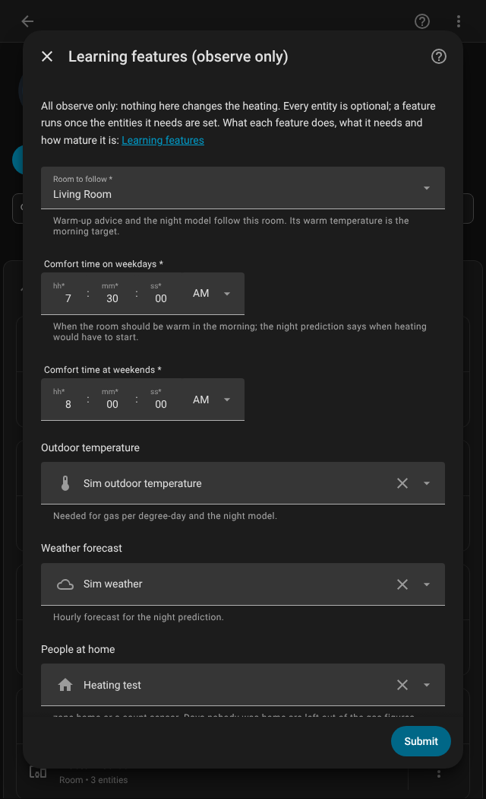

# Learning features (observe only)

**In one sentence:** optional features that record how your house and boiler behave and say what they would change, without changing the heating.

Earlier versions called them *experimental features*; the option, service and file names still use that word.

**Observe only** is the default: nothing here changes the heating (no setpoints, no PID values, no schedule), with one opt-in exception: **[Apply PID advice automatically](#applying-the-advice-automatically)** writes the PID advice to your Kp and Ki numbers.

## When you want it

When you want to know how your house heats: what a degree colder costs in gas, how fast the living room cools at night, and whether the boiler's PID values can do better. Most useful with an OpenTherm controller such as [`thermostat.yaml`](hardware.md#esphome-opentherm-thermostat-thermostatyaml). The heating control itself (rooms, TRVs, winner, heat source) does not depend on them.

## How to turn it on

They are off by default. **Settings > Devices & services > Cloudless Multiroom Thermostat > Configure > Features**, switch on **Learning features (observe only)**, then fill in the entities on the next page (later under **Configure > Learning features**). Every entity is optional; each feature runs as soon as the entities it needs are set. [The entities on the settings page](#the-entities-on-the-settings-page) explains each one and where to get it.

<p align="center"></p>

## What this is for

The aim is to learn how one room and the boiler behave, so the heating can later tune its own settings to the weather instead of running on fixed values. The room you pick under **Room to follow** (usually the living room: people are there and it leads the heating most often) is profiled:

- **How it warms up**: how the boiler's PID loop behaves on each warm-up, per outdoor temperature band (warm-up episodes).
- **How it cools down**: how fast the room loses heat at night (night cooldown model).
- **What it costs**: gas use corrected for the weather (gas per degree-day). This one covers the whole house and is the yardstick: it shows whether a change to the other two actually saved gas.

The end goal is **dynamic parameters**: PID values per outdoor band instead of one fixed set, and a morning start time that reaches the comfort temperature just in time (optimum start).

## When a feature is proven

What a feature needs is not only data but proof: does the model predict well, does the advice actually help, in more than one kind of weather. Each feature has a bar to clear. Until it does, it stays observe only. After it does, it may act on the heating, but only once you switch that on separately.

| Feature | Proven when | Then it may |
|---|---|---|
| Gas per degree-day | A full year of data (so a whole heating season), and with the boiler signals set, a measured (or set) hot-water rate | Serve as the official check for the other features |
| Night cooldown model | At least 30 predicted nights; in every outdoor band that occurs (5 or more of those nights) the average error is 0.3 °C or less and no night is off by more than 0.6 °C. Bands that don't occur aren't waited for | Optimum start: begin heating at the predicted time, only in confirmed bands |
| Warm-up episodes and PID advice | Confirmed in every outdoor band the house actually gets: each band with at least 5 of the last 30 warm-ups. A band is confirmed by [probing](#probing-values-that-get-no-advice) (neither a step up nor a step down was better, so the values were already right) or by a PID change (by hand or automatically): in that band, 5 or more valid episodes of the followed room after the change with less overshoot or a faster warm-up on average than the 5 before it in that band (or, when nothing before it can be compared, 5 that hold steady against a baseline of the first 5 after it), and gas per degree-day not worse | Set the PID values per outdoor band (gain scheduling) |
| Evening report | The features it reports on are proven | Stay as it is |

The night model counts its last 30 valid nights that had a prediction. A change is noticed when the effective gains of a warm-up differ from the warm-up before, whether you made it or [the advice was applied automatically](#applying-the-advice-automatically). Effective gains are Kp, Ki and Kd times what the PID output is multiplied by: the flow limit with `thermostat.yaml` (records from schema 3 on), otherwise 100. So a firmware change that rescales the output and the gains together, as `thermostat.yaml` did on 2026-11-07 (output times the flow limit instead of 0 to 100, Kp and Ki times 2.5), is the same controller and no change. There is one set of PID values for all weather, so a change is judged in every band it runs in: per band, its warm-ups on the new values against the 5 before the change in that band. One change can confirm several bands once the weather has varied; a later change replaces it.

Only the bands that occur need confirming: a band counts when at least 5 of the last 30 warm-ups of the followed room fell in it. The house adjusts to the weather it gets; it never waits for weather that doesn't come. A band that comes back with the season needs confirming again.

Only warm-ups with the same boiler flow limit and the same record schema are compared. When the change came together with a new flow limit or a schema change (a new version that measures differently), nothing before it can be compared. The first 5 warm-ups after the change in that band then become the baseline, and the band is confirmed once the next 5 hold steady against it: on average at most 0.1 °C more overshoot and at most 10% longer warm-up. The report names the change it judges and, per band, which path it is on, how many warm-ups are still needed and why nothing before it can be compared, for example:

> PID advice: 0 of 2 outdoor bands confirmed (0_8, 8_15 seen in the last 30 warm-ups), for the change of 2026-11-20 (Kp 1.75 → 1.9). 0_8: 2 of 5 warm-ups after the change, better so far (3 more warm-ups needed); 8_15: 1 of 5 warm-ups for a baseline (9 more warm-ups needed; nothing to compare with: no warm-ups in this band before it). Check gas per degree-day did not get worse

Only warm-ups count (top-ups are left out of the advice), so expect about one a day. Whether gas per degree-day got worse is left to you: one change does not move it enough to tell automatically.

The [evening report](#evening-report) shows where each feature stands against these numbers. They are a starting point and may be adjusted as more data comes in.

## Where each feature stands

| Feature | Stage | Needs | Output |
|---|---|---|---|
| [Gas per degree-day](#gas-per-degree-day) | **Checking**: running daily since October 2026, the figures are usable for comparing weeks | Gas meter, outdoor temperature. For the hot-water split also burner flame, hot water active, central heating active. Optional: people at home | `sensor.<system>_gas_per_degree_day`, plus [statistics sensors](#long-term-statistics) |
| [Night cooldown model](#night-cooldown-model) | **Learning**: first back-test was 0.2 to 0.8 °C off | Outdoor temperature, weather forecast, a room to follow | `sensor.<system>_night_prediction`, plus [statistics sensors](#long-term-statistics) |
| [Warm-up episodes and PID advice](#warm-up-episodes-and-pid-advice) | **Learning**: records reliably, advice not yet validated; applied only when you switch that on | Room to follow. Helpful: burner flame, outdoor temperature. For advice: Kp, Ki, Kd of a firmware PID (for example ESPHome) | `sensor.<system>_last_warm_up_overshoot`, `sensor.<system>_pid_advice`, plus [statistics sensors](#long-term-statistics) |
| [Evening report](#evening-report) | **Checking**: a summary of the above | Any of the above | `sensor.<system>_learning_features_report` at 21:00, plus a notification as chosen |

The stages:

- **Learning**: collecting data and building the model. Read what it says, don't act on it yet.
- **Checking**: the numbers are useful and are being checked against what really happens; details may still change.
- **Proven**: it cleared its bar (see [When a feature is proven](#when-a-feature-is-proven)) and may act on the heating once you allow it. None has got there yet.

The stages describe the learning features only: they learn and monitor, they don't run the heating. They are optional and off by default; the heating control itself (rooms, TRVs, winner, heat source, schedules) does not depend on them.

The analysis has run in one house (an Atag boiler on OpenTherm with an ESPHome PID) since October 2026; the stages above describe that analysis. If something looks wrong, please [open an issue](https://github.com/BarBaar44/Cloudless-Multiroom-Thermostat/issues).

## The entities on the settings page

The settings page asks for a lot of entities. You do not need all of them: each feature starts as soon as the entities it needs are set, and an empty field simply means less detail. This section explains every field: what it is, why it is asked for, whether you need it and where you can get it.

### Which fields each feature needs

✔ = needed for the feature to run, ○ = optional, adds detail, blank = not used.

| Field | Gas per degree-day | Night cooldown model | Warm-up episodes and PID advice |
|---|---|---|---|
| Room to follow | | ✔ | ✔ (advice only counts this room) |
| Comfort time on weekdays / at weekends | | ✔ | |
| Outdoor temperature | ✔ | ✔ | ○ (sorts warm-ups by weather) |
| Weather forecast | | ✔ (for the prediction) | |
| People at home | ○ | ○ | ○ |
| Gas meter | ✔ | ○ | ○ |
| Burner flame | ○ (hot-water split) | | ○ (short-cycling check) |
| Hot water active | ○ (hot-water split) | | ○ (skips hot-water disturbed warm-ups) |
| Central heating active | ○ (hot-water split) | | |
| Hot water gas rate | ○ (leave empty: measured) | | |
| Flow water temperature | | | ○ |
| Return water temperature | | | ○ |
| Boiler maximum flow temperature | ○ (stored per day) | | ○ (keeps warm-ups with a different limit apart) |
| Requested flow temperature | | | ○ ([heating curve data](#heating-curve-data), [low load](#low-load-detection)) |
| Boiler minimum power | | | ○ (leave empty: measured) |
| Boiler hot water setpoint | ○ (stored per day) | | |
| PID Kp, Ki, Kd | | | ✔ for advice (all three) |
| PID integral | | | ○ |
| Apply PID advice automatically | | | ○ (off: advice only) |
| Gas price before / after 06:00 | ○ (cost per day) | ○ | ○ (cost per warm-up) |

**A sensible start for most houses:** outdoor temperature, weather forecast and gas meter. That gives you gas per degree-day and the night model. The boiler fields only make sense with a smart (OpenTherm) boiler connection; the PID fields only with an ESPHome style PID.

**Long-term statistics.** Gas per degree-day reads Home Assistant's long-term statistics of the gas meter and the outdoor temperature, so both sensors need them. A sensor has them when it has a `state_class` (`measurement` for a temperature, `total_increasing` or `total` for a meter). Most integrations set this already. Check it under **Developer tools > Statistics**: if the sensor is listed there, it is fine.

### Room to follow

- **What:** one of your rooms, picked from a list.
- **Why:** the night model and the PID advice study one room in depth. Pick the room where people spend the most time and that leads the heating most often, usually the living room. Its **warm** temperature is the morning target for the night prediction.
- **Required:** yes, the form always has a value.
- **Where from:** your own rooms in this integration.
- **Renaming:** the room is matched by its id, not its name, so renaming it keeps its warm-up history. Each episode in `episodes.jsonl` stores the id of the room that led it (`room_id`). Older records without it, such as copied pyscript history, are matched by room name.
- **Changing it:** advice, the warm-up estimate, the night model and the progress check always use the room you follow now. Each night in `nights.jsonl` stores its room (`room_id`); older nights without one count for whichever room you follow. A warm-up recorded as `other_room` while another room was followed counts once you follow its room. A night in progress when you change the room is dropped.

### Comfort time on weekdays / at weekends

- **What:** the time in the morning by which the followed room should be warm.
- **Why:** the night prediction works out how cold the room will be at that time and when the heating would have to start to be warm by then.
- **Required:** yes, with defaults you can keep.
- **Where from:** your own routine.

### Outdoor temperature

- **What:** a sensor with the temperature outside, in °C.
- **Why:** almost everything here depends on the weather. Gas use is corrected for how cold it was (degree-days), the night model needs the difference between inside and outside to know how fast the room cools, and warm-ups are grouped by outdoor temperature so advice compares like with like.
- **Required:** for gas per degree-day and the night model, yes. Without it, warm-ups still get recorded but all land in one "unknown" weather group.
- **Where from:**
  - **Your own outdoor sensor** (Zigbee, Bluetooth, a weather station) is best: it measures your house's real outside. Place it in the shade, out of the sun and away from walls that warm up.
  - **Your boiler**, if it has an outdoor sensor and an OpenTherm connection (OpenTherm Gateway, ESPHome OpenTherm).
  - **A weather service** works too: many weather integrations (Buienradar, OpenWeatherMap) add a temperature *sensor*. The default Met.no integration only has a weather *entity*; you can turn its temperature into a sensor with a template sensor (device class temperature, state class measurement).

### Weather forecast

- **What:** a `weather` entity that offers an **hourly** forecast.
- **Why:** at 21:00 the night model reads tonight's expected outdoor temperatures to predict how cold the room will be in the morning. It also records the wind speed during the night, since wind cools a house faster.
- **Required:** for the prediction, yes. Without it nights are still recorded and learned from, but no prediction is made.
- **Where from:** Home Assistant sets one up for you at installation: Met.no, usually called `weather.forecast_home`. Buienradar, OpenWeatherMap and similar weather integrations also work, as long as they have an hourly forecast. If the forecast is missing, the Home Assistant log shows "No hourly forecast from …".

### People at home

- **What:** something that says how many people are at home, as a number.
- **Why:** days when nobody was home are left out of the gas figures, because an empty house uses less gas and would make the weather correction look better than it is. Warm-ups and nights also note how many people were home: people, cooking and appliances warm a room too.
- **Required:** no. Without it, every day counts and nothing is left out.
- **Where from:** `zone.home` (filled in for you when it exists). Its value is the number of **persons** inside your home zone, so it works when each person has a device tracker, usually the Home Assistant Companion app on their phone. A sensor that counts people in another way (for example a template sensor) works too.

### Gas meter

- **What:** a sensor with the **total** gas use in m³, the number that only goes up.
- **Why:** this is the gas use itself, the thing gas per degree-day measures. Nights and warm-ups also record how much gas they used.
- **Required:** for gas per degree-day, yes.
- **Where from:** in the Netherlands and Belgium, the smart meter's P1 port, read with the DSMR Smart Meter integration, a HomeWizard P1 meter or a similar dongle. If your gas already shows up in Home Assistant's **Energy** dashboard, that sensor is the right one. A daily or monthly usage sensor (one that resets) does **not** work.

### Burner flame, Hot water active, Central heating active

- **What:** three on/off sensors from the boiler: is the flame burning, is the boiler making hot water for a tap or shower, and is it heating the house.
- **Why:**
  - Together they split each day's gas into **hot water** and **heating**. Only the heating part depends on the weather, so without the split a long shower can look like a cold day. All three are needed for the split.
  - Burner flame also counts how often the boiler starts during a warm-up. Many short starts (short-cycling) wear the boiler and waste gas.
  - Hot water active lets warm-ups be skipped when a lot of hot water was used in the middle of one; the boiler then stops heating the house for a while and the warm-up does not show how the heating behaves.
- **Required:** no. Without them gas per degree-day still works, but uses an estimate for hot water.
- **Where from:** only boilers with a digital connection give these, usually **OpenTherm**:
  - the **OpenTherm Gateway** integration (OTGW),
  - an **ESPHome OpenTherm** board (flame, DHW active and CH active binary sensors),
  - a **DIYLess** thermostat,
  - some manufacturers' own integrations.
  A boiler switched by a simple relay (on/off) cannot report these.

### Hot water gas rate

- **What:** how much gas the boiler burns per minute while it makes hot water, in m³ per minute. **Leave it empty**: the integration measures it.
- **Why:** in an hour with both heating and hot water (a combi boiler takes turns: hot water interrupts heating), the hot-water part of that hour's gas is its hot-water minutes times this rate. With the wrong rate, gas shifts between hot water and heating, and gas per degree-day is off.
- **How it is measured:** from draws outside heating hours. A draw counts when the hours on both sides had no heating, no burner and no hot water, so no heating gas leaks in and gas the meter reports an hour late is still caught. The rate is the draws' total gas over their total hot-water minutes, from the last 60 split days. Until 60 minutes are collected the split uses **0.019 m³/min** (measured on one boiler, about 11 kW on hot water). The evening report says which rate is in use and how many minutes it is based on; the gas per degree-day sensor has it as attributes.
- **Short draws are left out.** A draw under 3 minutes of hot water (washing hands, a quick rinse) is too noisy: the meter's resolution and the boiler's start-up dominate. If your house mostly has short draws, collecting 60 minutes takes longer.
- **Built and tested in one house** where the boiler's hot water only goes to the bathroom (the kitchen has its own supply). Where the kitchen and other taps also use the boiler, the measured rate mixes showers with lower-flow draws. That should still be the right average for the split, but it has not been checked.
- **Required:** no. Only matters when burner flame, hot water active and central heating active are set.
- **Setting it:** only to pin a value you measured yourself (gas meter change during a shower with the heating off, divided by the hot-water minutes). A set value always wins over the measured one.
- **Changing it:** only days split after the change use the new rate. Days already split keep theirs, because Home Assistant keeps the boiler history for 7 days only. Each split day stores the rate it used and where it came from (`dhw_rate`, `dhw_rate_source` in `gas_days.jsonl`).

### Flow water temperature, Return water temperature

- **What:** two sensors in °C. *Flow* is the water leaving the boiler towards the radiators, *return* is the water coming back.
- **Why:** recorded with each warm-up and shown in the report (highest flow, average return), so you can see how hard the boiler worked. A condensing boiler is most efficient when the return water stays below about 55 °C: then it recovers extra heat from its exhaust. With the return set, each warm-up also gets its [condensing share](#condensing-share).
- **Required:** no. They do not affect the advice.
- **Where from:** the same sources as the flame sensors: OpenTherm Gateway, ESPHome OpenTherm, DIYLess.

### Boiler maximum flow temperature, Boiler hot water setpoint

- **What:** two entities in °C: the highest flow temperature the thermostat asks for, and the boiler's hot water setpoint (OpenTherm ID 56). They are only read, never written.
- **Why:** the maximum flow temperature caps what the PID can ask for. Lower it from 50 to 40 °C and warm-ups get slower with less overshoot, whatever the PID values are. The PID advice limits also follow it (see [the PID values](#pid-kp-pid-ki-pid-kd)). Each warm-up stores the limit (`max_ch`), advice only combines warm-ups with the same limit, and the [progress check](#when-a-feature-is-proven) only compares warm-ups before and after a PID change that had the same limit. A warm-up during which the limit changed is skipped (`max_ch_changed`). Each gas day stores both settings in effect at the end of the day (`max_ch`, `dhw_setpoint` in `gas_days.jsonl`), so you can see what a lower hot water setpoint did to the hot-water gas. When either setting changes, the next evening report says so.
- **Required:** no. Without them nothing changes; older records without `max_ch` are only compared with each other.
- **Where from:** for the flow limit, the entity that sets the limit: with [`thermostat.yaml`](../thermostat.yaml) the **Central heating max flow temperature** number. The boiler's own maximum (ESPHome OpenTherm `max_t_set`, an OpenTherm Gateway) only fits when the thermostat really stops there; on the ATAG this was built on, the boiler followed requests above its panel maximum. For the hot water setpoint: ESPHome OpenTherm `t_dhw_set`, DIYLess, or an OpenTherm Gateway. **Don't make the hot water setpoint changeable from Home Assistant** just to see it: some boilers stop working when a thermostat sends it (see [Atag E325EC](boiler-notes.md#atag-e325ec-set-the-hot-water-temperature-on-the-boiler-never-from-the-thermostat-c1-51)).

### Requested flow temperature

- **What:** a sensor in °C: the flow temperature the thermostat asks the boiler for at this moment. Only read.
- **Why:** to check that the flow really stays at the [flow limit](#boiler-maximum-flow-temperature-boiler-hot-water-setpoint), and to collect data for a heating curve later. Each warm-up stores the highest and average request (`flow_req_max`, `flow_req_avg`) and the minutes the request was above the limit (`req_above_limit_min`). See [Heating curve data](#heating-curve-data).
- **Required:** no. Without it the warm-ups still record how long the real flow ran above the limit.
- **Where from:** with [`thermostat.yaml`](../thermostat.yaml) the **Central heating requested flow temperature** sensor. Other thermostats: whatever shows the control setpoint (OpenTherm ID 1), for example an OpenTherm Gateway.

### Boiler member ID, Boiler maximum capacity, Boiler minimum modulation

- **What:** sensors with what the boiler reports about itself over OpenTherm: its member ID (a number per manufacturer, ID 3), its maximum capacity in kW and its minimum modulation in % (ID 15). Only read.
- **Why:** the evening report shows them on a "Boiler:" line. Capacity times minimum modulation gives the [boiler minimum power](#boiler-minimum-power) without measuring. The member ID is groundwork for boiler profiles (v2.2): it will only ever *suggest* a make, which you confirm ([#107](https://github.com/BarBaar44/Cloudless-Multiroom-Thermostat/issues/107)).
- **Required:** no. Not every boiler answers these messages; an unknown value is skipped, and a minimum modulation of 0 % (often "not supported") is ignored.
- **Where from:** with [`thermostat.yaml`](../thermostat.yaml) the **Boiler member ID**, **Boiler maximum capacity** and **Boiler minimum modulation** sensors (read once at boot). An OpenTherm Gateway shows the member ID in its own integration. See [Thermostat requirements](thermostat.md).

### Boiler minimum power

- **What:** the boiler's smallest burner power in kW (the minimum load in its manual).
- **Why:** below it the boiler can only cycle. Shown in the evening report; buffer rooms (#80, after v2.0) will use it.
- **Required:** no. Leave it empty and it comes from the boiler (maximum capacity times minimum modulation, when it reports them), otherwise it is [measured](#low-load-detection). Set it only to pin the value from the manual.

### PID Kp, PID Ki, PID Kd

- **What:** the three tuning values of the PID controller in your boiler firmware that decides the flow temperature. Roughly: **Kp** reacts to how far the room is below target, **Ki** to how long it has been below, **Kd** to how fast the temperature changes.
- **Why:** the PID advice suggests a better value for one of these. It needs to know the current values to suggest a change, and it notices when one changes so it can check whether the change helped. With [Apply PID advice automatically](#applying-the-advice-automatically) on, it writes Kp and Ki itself, so they must be **number** or **input_number** entities it can set.
- **Required:** all three for advice. Without them warm-ups are still recorded and judged, but no advice is given.
- **Where from:** an ESPHome firmware with a PID climate, where the values are exposed as **number** entities (or kept in **input_number** helpers that match what you flashed). The advice limits (Kp 0.3 to 1.5, Ki 0.0005 to 0.01, Kd 0 to 2000) fit an ESPHome PID driving an OpenTherm flow temperature on a 0 to 100 °C range. The PID output is a fraction of the flow range, so with the **Boiler maximum flow temperature** set the limits scale by 100 / limit: at 40 °C they are Kp 0.75 to 3.75, Ki 0.00125 to 0.025, Kd 0 to 5000. Without that field the 0 to 100 limits apply, so the 40 °C starting values of `thermostat.yaml` get no advice until you set it. **If your boiler has no such PID, leave these empty**: the advice would not make sense for it.

### PID integral

- **What:** a sensor with the PID's integral term: the part of its output built up from how long the room has been below target.
- **Why:** recorded with each warm-up (lowest and highest value) to help explain an overshoot: an integral that keeps building up is a classic cause.
- **Required:** no. It does not affect the advice.
- **Where from:** ESPHome's PID climate can publish it as a sensor (`type: INTEGRAL`). ESPHome reports it as a percentage (times 100); the integration divides it by 100. A sensor from other firmware that reports the plain value would come out 100 times too small: leave the field empty, or feed it a template sensor that multiplies by 100.

### Gas price tomorrow before 06:00 / after 06:00

- **What:** two sensors with the gas price for tomorrow, before and after 06:00.
- **Why:** dynamic gas contracts change price at 06:00. The prices are shown next to the night prediction, so you can see whether starting the heating a bit earlier would be cheaper. They also give each warm-up and each day a [cost](#cost-per-warm-up-and-per-day).
- **Required:** no, purely informational.
- **Where from:** an integration for a dynamic energy contract, such as Frank Energie, Zonneplan, Tibber or EnergyZero. These usually give the current price or a list of prices; you may need a template sensor to pick tomorrow's price before and after 06:00.

## Gas per degree-day

**Question it answers:** did a change (a new setpoint, PID values, a schedule) save gas?

Raw gas use per day mostly follows the weather, so it can't show that. The feature normalises it with **degree-days**: base 18 °C, so a day averaging 8 °C outside counts 10. It reports **heating gas per degree-day** over the last 7 days (the sensor value) and 28 days (an attribute). It reads Home Assistant's long-term statistics of the gas meter and the outdoor temperature, up to a year back, so it has values straight away. Single days are too noisy in mild weather (one shower more or less outweighs the heating), which is why only rolling values are reported.

- **Hot water is split off per day.** When burner flame, hot water active and central heating active are set, each complete day is split into hot-water and heating gas from the hourly gas statistics and the boiler history. An hour without heating demand burned only for hot water. In an hour with heating demand, the hot-water part is its hot-water minutes at the [hot water gas rate](#hot-water-gas-rate), which the integration measures from showers outside heating hours (0.019 m³ per minute until it has enough). Home Assistant keeps that history for 7 days, so each split is stored as it is made. Days before the first split use a base estimate instead: the median measured hot-water gas, or the median gas on summer days without heating.
- **Days nobody was home are left out.** With **People at home** set (`zone.home` by default), a day counts as away only if nobody was home for the whole calendar day. The day you come back stays in: warming the house up again is real gas the trip cost.

**Gas meter:** a total meter in m³ with long-term statistics (for example a P1 or HomeWizard gas meter). The sensor shows `unknown` until a 7-day window holds at least 5 degree-days.

## Night cooldown model

**Question it answers:** how cold will the room be tomorrow morning, and when would the heating have to start to be warm in time?

When the heating goes off in the evening (no room that drives the heat source heating any more, between 18:00 and 02:00; a room with **Drives the heat source** off, such as a hallway on eco, doesn't count), a **night** starts. Every 10 minutes it samples the room you chose under **Room to follow**, the outdoor temperature, wind, that room's windows, the sun and how many people are home, until the heating comes back on (or 11:00). Nights shorter than 4 hours are ignored.

- **The quiet part of the night** (from 01:00 until sunrise or until heating starts, windows closed, on the morning the night runs into: the next day, or the same day for a night that starts after midnight) follows Newton's law of cooling, `dT/dt = -k * (T_room - T_outdoor)`, with time constant tau = 1/k.
- **The evening does not follow that law.** People, cooking and appliances keep a living room warm for a few hours after the heating stops, then it drops around bedtime. That part is learned as a plain number: the evening drop from 21:00 to 01:00. Only nights during which the heating was already off at 21:00 can measure it (the prediction applies it from 21:00); a night that starts later still teaches the cooling rate.

At 21:00 it takes the hourly forecast and predicts the room temperature at your **comfort time** (weekday and weekend times are settings). From the warm-up speed of earlier morning warm-ups in a similar outdoor temperature, it says when heating would have to start to reach the room's **warm** temperature by then. The next morning the prediction is compared with what really happened.

**Why still learning:** predictions start after 2 valid nights and 2 morning warm-ups. In the house it was built in, a back-test on the first 9 evenings was off by 0.2 to 0.8 °C. It needs many more nights before it can drive anything (for example an optimum start).

**The weather it gets** ([#139](https://github.com/BarBaar44/Cloudless-Multiroom-Thermostat/issues/139)): outdoor temperature is an input of the model, so it has to prove itself in each kind of night separately. But it doesn't wait for weather that doesn't come: only the bands with 5 or more of the last 30 predicted nights must hold. A new kind of night (the first frost) shows as "not confirmed yet" until it has 5 nights that hold; optimum start won't act in a band before that. The evening report shows it per band:

```
Night model: 30 of 30 predicted nights, 2 of 2 outdoor bands confirmed. below 0 °C: 2 of 5 nights (not confirmed yet); 0 to 8 °C: 14 nights, average error 0.12, worst 0.3 (holds); 8 to 15 °C: 14 nights, average error 0.18, worst 0.5 (holds)
```

### Cooling per room

Every night also samples every room, and fits each room's cooling by the same rules: quiet part only, its own windows closed (an open window makes that room's night invalid, reason `window`), enough difference with outside ([#102](https://github.com/BarBaar44/Cloudless-Multiroom-Thermostat/issues/102)). It is stored per room id in the night record (`rooms`), so renaming a room keeps its history.

The time constant per room (median of its last 7 valid nights, after 2) is in the `cooling_per_room` attribute of `sensor.<system>_night_prediction` and in the evening report: "Cooling per room (time constant, higher keeps heat longer): Living Room 40 h (7 nights), Office 22 h (5 nights)". A room that cools fast needs to start earlier, and a well insulated room can coast longer. That is what comfort times per room and the buffer rooms will build on. Observe only: the prediction still uses the room to follow.

## Warm-up episodes and PID advice

**Question it answers:** is the boiler's PID loop tuned well for this house?

Once a minute it samples the heat source target, the winning room's temperature, flame, hot water, flow and return temperature, the boiler's maximum flow temperature, outdoor temperature and the gas meter. The highest flow temperature of an episode (`water_peak`) leaves out minutes with hot water: a combi boiler runs much hotter for a tap than for the radiators. An **episode** starts when the winning room drops more than 0.1 °C below target. From the start it follows that room's temperature and target, also after it reaches the target and no room wins any more. It ends after 4 hours without reaching the target, or when heating stops. Once the room reaches the target, a **watch** follows: it measures how far the room overshoots and dips, and how often the burner starts. The watch ends:

- at the **first reheat**: the burner starts again for heating after it went off. What comes after that is the next heat, not this warm-up. A hot-water draw doesn't count.
- when heating stops, the target changes, another room starts winning or the room's window pauses heating. The episode is judged on what came before, if the watch lasted at least 20 minutes.
- after 90 minutes at the latest.

Each record stores how long the watch lasted (`watch_min`) and why it ended (`watch_end`: `reheat`, `heating_stopped`, `target_changed`, `winner_changed`, `garden_doors` or `cap`).

An episode in progress survives a restart, such as one to install an update: it's saved every 5 minutes and when Home Assistant stops, and the minutes it missed are filled with the last sample. After a gap of more than 15 minutes the episode is dropped.

Each episode is judged on time to target (more than 60 minutes is slow), overshoot (more than 0.4 °C), the dip below target afterwards (more than 0.4 °C) and flame starts per hour (more than 6 is short-cycling). A [low-load](#low-load-detection) warm-up is never called short-cycling or swinging: there the cycling comes from the boiler, not from the PID.

- **Only episodes led by the room to follow count for the advice that can be applied.** Others are recorded (reason `other_room`), get [advice of their own](#advice-per-room), and count again if you follow their room later.
- **Only warm-ups count, not top-ups.** An episode that starts less than 0.5 °C below target is a **top-up** (`kind: top_up`): the burner reheating a room that sits just below target. Top-ups are valid records, shown in the report with "top-up (not used for advice)", but the advice, the progress check and the automatic changes leave them out. On a boiler whose minimum output is well above the room's load, one burn overshoots whatever the PID values are, so top-ups would push Ki down for nothing. Since 1.5.0 the watch ends at the first reheat, so a quiet afternoon can produce several top-ups. Whether top-ups would gain from PID values of their own is an open question: the records keep them so that can be checked later. Older records are sorted the same way, from their target and start temperature.
- **Disturbed episodes are skipped:** winner or target changed, or that room's window paused heating, before the room reached the target or within 20 minutes after; heating stopped in that time; more than 10 minutes of hot water; the boiler's maximum flow temperature changed; or shorter than 30 minutes.
- **Advice needs agreement:** the last 2 valid episodes in the same outdoor band (below 0, 0 to 8, 8 to 15, above 15 °C) and with the same boiler maximum flow temperature must point the same way. Only records of one schema are compared, here and in the before and after comparison of a PID change. Schema 1 (before 1.5.0) watched 90 minutes, so it measured other heat too. Schema 3 (1.6.0) starts the history over once more: top-ups are left out, and with the flow limit number of `thermostat.yaml` the recorded limit is the one the thermostat really asks for, where a schema 2 record with limit 40 could have run with 50. Then exactly one value moves by 10%: overshoot means lower Ki; swinging or short-cycling means lower Kp; slow without overshoot means raise Kp. Hard limits: Kp 0.3 to 1.5, Ki 0.0005 to 0.01, Kd 0 to 2000 for a 0 to 100 °C flow range, scaled by 100 / the recorded flow limit when there is one. A value outside its range gets no advice ("outside the range the advice knows"): moving it into the range could go against the verdict, and it usually means another PID scale.
- **Advice only appears when Kp, Ki and Kd are all set.** Without them the advice sensor says "no PID numbers configured". When they are set but have no value (the device is offline, or still connecting after a restart) it says "PID numbers unavailable", keeps the stored advice, and shows it again as soon as the numbers have values. Those limits fit an ESPHome PID climate driving an OpenTherm flow temperature; for another controller they may not make sense.

**Why still learning:** no advice has been applied and checked yet. Without the option below it says what it *would* do, nothing more.

### Advice per room

Every room that has led at least 2 valid warm-ups gets its own advice, judged on its own warm-ups by the same rules. It is observe only: never applied, also with **Apply PID advice automatically** on. There is one PID in the thermostat, and it follows the room to follow.

It answers a question for later: do rooms warm up so differently that each needs PID values of its own ([#82](https://github.com/BarBaar44/Cloudless-Multiroom-Thermostat/issues/82))? If the rooms keep getting the same advice, one set of values fits the house. If they don't, the advice per room is where each room's values start.

You find it in the `per_room` attribute of `sensor.<system>_pid_advice` (room, whether it is the room to follow, number of warm-ups, advice) and in the PID section of the evening report, under "Per room (observe only, never applied)". Rooms with fewer warm-ups are left out; a room that does not drive the heat source never leads a warm-up, so it never shows up.

### Applying the advice automatically

With **Apply PID advice automatically** on (off by default, on the learning features page), the advice is not only reported but written to your Kp or Ki number after the warm-up that produced it. This is how the advice proves itself: a change has to be applied before the progress check can see whether it helped.

Guardrails:

- **One value, one small step:** the advice's own 10% step, rounded to the number's step, never outside the [limits](#pid-kp-pid-ki-pid-kd) for the current flow limit. Kd and the flow limit are never written.
- **Its own warm-ups first:** a change is only made when the warm-ups the advice is based on ran on the current values. After a change, 2 valid warm-ups of the followed room in the same outdoor band, flow limit and schema decide whether it stays. Until then nothing else changes.
- **Revert when not better:** the problem the advice acted on must be smaller on average than in the 2 warm-ups before (overshoot for Ki, flame starts or undershoot for swinging, warm-up time for slow), and the other one of a pair must not get worse. Otherwise the old value is written back, and that same change is never tried again.
- **You can always take over:** change Kp, Ki or Kd yourself and the check in progress ends without a revert.
- **No check waits forever:** after 14 days without 2 such warm-ups (the weather moved to another band, few clean mornings) the check ends as inconclusive and the change stays. There is no evidence it made things worse, and the next advice can follow.
- **Only warm-ups:** top-ups are left out of the advice and of the check.
- **Failures never block heating:** a value that can't be written is logged and tried again after the next warm-up.

### Probing values that get no advice

Advice only comes when a warm-up misses a target, so values that are already good would never be tested, and the feature could never show it works. With **Apply PID advice automatically** on, the integration therefore also probes:

- **When:** 5 warm-ups in a row of the followed room ran on the current values and met every target (no overshoot above the limit, no swinging, not slow), and there is no advice.
- **What:** Kp one 10% step up, rounded to the number's step and inside the limits. 5 warm-ups in the same outdoor band, flow limit and schema then decide.
- **Better** (less overshoot or a faster warm-up on average, the other not worse than the warm-ups before the probe): the new value stays, and the next probe starts from it after another 5 good warm-ups.
- **Not better:** the old value is written back and Kp is probed one step down the same way. Neither direction better: the values are **confirmed optimal** for that band, flow limit and schema, and are not probed there again until they change.
- **Safety:** a probe warm-up that misses a target ends the probe at once and writes the old value back. A probe without 5 warm-ups after 14 days is reverted too: unlike advice, nothing asked for it.
- **Advice first:** advice always wins; a probe only starts when there is none. Changing Kp, Ki or Kd yourself ends a probe without a revert, as with advice.

A confirmed optimum counts towards [proven](#when-a-feature-is-proven) the same way as a change that helped.

The evening report shows every change (applied, probed, kept, reverted, dropped, inconclusive, failed), confirmed optima and the check or probe in progress. The PID advice sensor's `mode` attribute says `auto` or `observe`.

Turning it on doesn't change the 21:00 report's other parts or any other feature: they stay observe only.

## Evening report

> **Moves in v2.1.0:** the 21:00 report, this report sensor, the Evening notification option and the `experimental_report` service stay in v2.0 and go in v2.1. The information moves to live sensors (with long-term statistics), events and a learning view in the card ([#119](https://github.com/BarBaar44/Cloudless-Multiroom-Thermostat/issues/119)). Don't build new dashboards or automations on the report.

Every evening at 21:00 the report is written to **`sensor.<system>_learning_features_report`**. It lists today's warm-up episodes, the current PID values and advice, a line when the boiler's maximum flow temperature or hot water setpoint changed since the last report, the last night, tonight's prediction, gas per degree-day and the learning progress of each feature (when it is proven), with a link to this page. Call the service `cloudless_multiroom_thermostat.experimental_report` to get it on demand as a notification (it then shows the stored prediction instead of making a new one). "Since the last report" means since the last 21:00 report: a report on demand shows a boiler change but doesn't count as a report, so the evening report still shows it.

### The report sensor

The state is the time of the last report. The attributes hold the report by section, so a dashboard can show all of it or only a part:

| Attribute | Content |
|---|---|
| `text` | The whole report (Markdown) |
| `summary` | Up to three short lines: warm-ups today, PID advice, night start and gas per degree-day |
| `events` | What happened since the last evening report (see below); empty on a quiet day |
| `warm_ups`, `pid`, `automatic_changes`, `night`, `progress` | Lines of each section |
| `boiler`, `gas` | One line each (`boiler` is empty when nothing changed) |

The sensor keeps its last report over a restart. It only holds the latest report; the history stays in the files below, and the trends in Home Assistant's long-term statistics of the gas per degree-day and last warm-up overshoot sensors (plot them with a statistics graph card).

A Markdown card that shows the report (for a system called "Heating"):

```yaml
type: markdown
title: Learning features
content: >
  {{ state_attr('sensor.heating_learning_features_report', 'text') }}

  *{{ as_timestamp(states('sensor.heating_learning_features_report')) | timestamp_custom('%a %d %b %H:%M') }}*
```

Only the summary and events, for a smaller card:

```yaml
type: markdown
content: >
  {{ state_attr('sensor.heating_learning_features_report', 'summary') | join('\n\n') }}
  
  

  **Today:**

  {{ events | join('\n') }}
  
```

### Evening notification

The option **Evening notification** on the learning features page decides what the 21:00 report posts as a persistent notification:

- **Events only** (default): only when something happened that day: an automatic PID change applied, kept, reverted, dropped, inconclusive or failed; a boiler setting changed; a feature proved itself or needs more data again; an unreadable learning file was moved aside. A quiet day posts nothing.
- **Short summary**: up to three lines every evening, plus the events.
- **Full report**: the whole report every evening, as before 1.7.0.
- **Off**: no notification. The sensor and the report on demand still work.

The time is fixed at 21:00 because the night model measures the evening drop from 21:00.

If the weather forecast is unavailable at 21:00, the report says there is no prediction and the forecast is tried again at 22:00 and 23:00. When a retry works, the prediction is made as of 21:00 (the room temperature then, with the new forecast) and the report is replaced (the sensor, and the notification with Short summary or Full report). A restart of Home Assistant in between cancels the retries.

## Heat-up model per room

**Question it answers:** how does each room respond to heat? After how many minutes does it start to rise (dead time), how fast does it then rise (time constant), and how much warmer does it get per degree of flow (gain)? ([#152](https://github.com/BarBaar44/Cloudless-Multiroom-Thermostat/issues/152), step 2 of [#135](https://github.com/BarBaar44/Cloudless-Multiroom-Thermostat/issues/135).)

Every warm-up keeps its minute samples (since 1.8.3). From them each warm-up gets a fit of a first order plus dead time model: the room's rise against the [requested flow](#requested-flow-temperature) (the flow water temperature when the request isn't known). Hot water minutes count as no heat; an open window or a target change ends the data. It needs 20 minutes and a rise of 0.3 °C. The kept samples from before this release are fitted too.

**Predicted against real:** once a room has 5 fitted warm-ups in an outdoor band, the median of its last 7 is its model in that band. Every next warm-up there is first predicted with that model, using the flow it really got, and then compared: did the room reach its target when the model said? The evening report shows it per room and band, for example:

```
- Heat-up model per room: Living Room (0 to 8 °C: dead time 12 min, time constant 95 min, gain 0.081, reaches target within 9 min of the prediction (6 predicted); 8 to 15 °C: 3 of 5 warm-ups fitted)
```

The same is in the `heatup` attribute of the report sensor; the records are in `heatup.jsonl`.

**What it is for:** calculating PID gains per room and per forecast instead of finding them by trial and error. That changes the heating, so it waits for a PID per room after v2.0 ([#82](https://github.com/BarBaar44/Cloudless-Multiroom-Thermostat/issues/82)). Until then this only learns and checks itself.

**Sensor resolution matters:** a room sensor in steps of 0.1 °C makes the time constant come out too low (fewer than 1 in 10 minutes shows a change). Sensors with 0.01 °C steps, such as reflashed LYWSD03MMC, fit well.

**Why still learning:** a first model, observe only.

## Hold profile: coast after top-ups

**Question it answers:** once the room is warm, how far does it keep rising after a reheat? ([#163](https://github.com/BarBaar44/Cloudless-Multiroom-Thermostat/issues/163).)

During the day the burner reheats a warm room in short top-ups. The flame stops when the room is back at target, but the water in the radiators still carries heat, so the room keeps rising after the burner is off. That rise is the **coast**. In the house this was built in it is most of a top-up's overshoot (about 0.3 °C in the morning, up to 0.8 °C late in the afternoon), and it happens after the burner stopped, so PID values can't reach it.

Each top-up with kept minute samples gets a record: the coast (room peak after the flame stopped minus the room when it stopped), the room against target when the flame stopped, the dip before the reheat, the burn length, the highest requested flow and the hour. A target change or an open window ends the data; it needs 10 minutes after the flame stops, and a burn with more than 2 minutes of hot water is left out. The kept samples from before this release are measured too.

**Predicted against real:** the coast is modelled per room, time of day (before 10:00, 10:00 to 13:00, 13:00 to 15:00, after 15:00) and outdoor band. Once a cell has 5 coasts, the median of its last 9 is its model; until then the time of day block over all bands stands in, once it has 5. Every next top-up is first predicted and then compared. The evening report shows it per room and time of day, for example:

```
- Coast after top-ups (rise after the burner stops): Living Room, 38 top-ups: before 10:00 0.25 °C (10), predicted within 0.05; 10:00 to 13:00 0.39 °C (14), predicted within 0.15; 13:00 to 15:00 0.33 °C (9), predicted within 0.13; after 15:00 0.77 °C (5)
```

The same is in the `hold` attribute of the report sensor; the records are in `hold.jsonl`.

**What it is for:** stopping a top-up early by the predicted coast, so the room lands on target instead of above it ([#164](https://github.com/BarBaar44/Cloudless-Multiroom-Thermostat/issues/164), after v2.0). That changes the heating, so this only learns and checks itself until then.

**Why still learning:** a first model, observe only.

## Cost per warm-up and per day

**Question it answers:** what did the heating cost? Kept now so v2 starts with a cost history ([#109](https://github.com/BarBaar44/Cloudless-Multiroom-Thermostat/issues/109)). Needs the [gas price sensors](#gas-price-tomorrow-before-0600--after-0600) and a gas meter.

- **Prices:** the price sensors as they were at 21:00 the evening before, when they give the coming day's prices (the night prediction reads them at the same moment). Before 06:00 the first price applies, from 06:00 the second. They are read from Home Assistant's history, so a day or warm-up that is processed more than about 10 days later (the recorder's default) gets no cost.
- **Per warm-up:** `gas_price` (at its start) and `cost` (its gas use times that price), in the evening report ("gas 0.8 m3 cost 1.12") and as attributes of the last warm-up overshoot sensor. The gas comes from the meter at the start and end of the warm-up, so with a meter that reports every few minutes it is an estimate.
- **Per day:** `gas_price_before6`, `gas_price_after6` and `cost` in `gas_days.jsonl`: each hour's gas at the price of that hour. Shown with the day's gas in the evening report. Stored with the [hot water split](#burner-flame-hot-water-active-central-heating-active), so it needs those three sensors too.

The amount is in the unit of the price sensors (for example euro). A fixed price contract works too: point both fields at the same sensor (a template sensor with your price).

**Why still learning:** data collection only.

## Low-load detection

**Question it answers:** is the boiler short-cycling because the room needs less heat than its smallest flame? ([#103](https://github.com/BarBaar44/Cloudless-Multiroom-Thermostat/issues/103), phase 1 of [#80](https://github.com/BarBaar44/Cloudless-Multiroom-Thermostat/issues/80)). Then every burn heats the water faster than the radiators give it off, the flow overshoots, the boiler stops itself and waits its anti-cycle time. No PID value prevents that. Example from the reference house: a bedroom of about 2.5 kW on a boiler with a 6.1 kW minimum, burns of 3 minutes, off for 5, about 6.5 starts an hour.

Each warm-up stores:

| Field | Meaning |
|---|---|
| `burn_avg_min`, `burn_min_min` | average and shortest burn for heating, in minutes |
| `off_avg_min`, `off_min_min` | average and shortest pause between two burns |
| `burns_end_hot` | burns that ended with the flow more than 1 °C above the [requested flow](#requested-flow-temperature) (without it: at the flow limit) |
| `low_load` | more than 6 starts an hour, and at least half of the burns ended hot. Empty without flow data |

Samples are one a minute, so burns and pauses are rounded to whole minutes. Burns with hot water, and burns cut off at the start or end of the warm-up, are left out.

**What it changes:** a low-load warm-up never gets the verdict "swinging or short-cycling", so the advice never lowers Kp for it and **Apply PID advice automatically** never acts on it. Overshoot and a slow rise still count. The evening report marks it: "low load: 6.5 starts/h, burns 3.4 min, off 5.1 min (not a PID problem)".

**Boiler minimum power:** measured from low-load warm-ups without hot water, where the boiler burns at its minimum: gas used over burner minutes, converted with the calorific value of Dutch gas (9.77 kWh/m³). It needs a gas meter and 60 burner minutes in low-load warm-ups; until then the report says "measuring". A gas meter that reports every few minutes makes this an estimate. The [setting](#boiler-minimum-power) replaces it, and so does what the boiler reports ([maximum capacity and minimum modulation](#boiler-member-id-boiler-maximum-capacity-boiler-minimum-modulation)): setting first, then the boiler, then measured. The report shows the line once there is a low-load warm-up or a value.

**Why still learning:** observe only; nothing changes in the heating. What helps against low load (buffer rooms, a fixed burn and pause in the firmware) comes after v2.0 (#80).

## Condensing share

**Question it answers:** how much of the burner time was the boiler condensing? A condensing boiler gets up to about 10% more heat out of the same gas when the return water is below about 55 °C, because the water vapour in its exhaust then condenses on the heat exchanger ([#105](https://github.com/BarBaar44/Cloudless-Multiroom-Thermostat/issues/105)).

Each warm-up stores the share of minutes the burner heated (not hot water) with the return below 55 °C (`condensing_pct`). The evening report shows it per warm-up ("condensing 74%"), the last warm-up overshoot sensor has it as an attribute, and `sensor.<system>_last_warm_up_condensing_share` keeps it in the [long-term statistics](#long-term-statistics).

Together with the [heating curve data](#heating-curve-data) it lets a lower flow limit be judged on gas, not only on comfort: a lower limit usually raises the share. Needs the [return water temperature](#flow-water-temperature-return-water-temperature).

**Why still learning:** data collection only; 55 °C is a rule of thumb, the real dew point depends on the boiler and the gas.

## Heating curve data

**Question it answers:** which flow limit does this house need at which outdoor temperature? That is the start of a heating curve: Home Assistant lowering the flow limit on mild days and raising it in a frost ([#75](https://github.com/BarBaar44/Cloudless-Multiroom-Thermostat/issues/75)). This release only collects the data; nothing changes the limit.

Two things have to be known first ([#104](https://github.com/BarBaar44/Cloudless-Multiroom-Thermostat/issues/104)):

1. **Does the flow stay at the limit?** Each warm-up stores the minutes the real flow ran more than 2 °C above the flow limit (`flow_above_limit_min`), its average while the burner heated (`water_avg`), and, with the [requested flow temperature](#requested-flow-temperature) set, the same for the request. A request above the limit means the thermostat asks for too much; a request at the limit with the real flow above it means the boiler overshoots its own setpoint, which happens when its smallest flame is more than the radiators can take. Minutes with hot water are left out.
2. **Warm-ups at one fixed limit across the weather.** Keep the flow limit the same for a while and let the cold and mild mornings come.

The evening report has a line for it, for example:

```
Heating curve data at flow limit 40 °C: 14 warm-ups (outdoor below 0: 2, 0 to 8: 10, 8 to 15: 2, above 15: 0 °C). Flow more than 2 °C above the limit in 3 of 14 (highest 49 °C); requested flow above the limit in 0 of 14
```

It counts warm-ups (not top-ups) of every room that weren't disturbed, at the limit of the latest warm-up. Change the limit and the count starts again, as warm-ups at another limit aren't comparable. Change one thing at a time.

**Why still learning:** data collection only.

## Heating curve learned

**Question it answers:** which flow limit does this house need per outdoor band? Learned from daily use, without a calibration run, so the heating curve ([#75](https://github.com/BarBaar44/Cloudless-Multiroom-Thermostat/issues/75)) starts from measured values ([#167](https://github.com/BarBaar44/Cloudless-Multiroom-Thermostat/issues/167)). Uses the room to follow.

**Hold flow.** Once the room is warm, the burner reheats it in short top-ups. Two top-ups in a row are a hold interval: the burner minutes of the first (hot water minutes left out) over the time until the second starts is the share of time the house needed the burner to stay on target. A radiator gives off heat roughly in proportion to how much warmer its water is than the room, so burning 10% of the time with 40 °C water in a 20 °C room is about what a steady 22 °C would do. That steady value is the **hold flow**: what the house needs at that outdoor temperature, whichever flow limit was set when it was measured. The water temperature is taken when the burner stops, else the warm-up's peak, else the flow limit.

Left out: intervals shorter than 10 minutes or longer than 3 hours, a target change in between, a burn with hot water, and low-load episodes (the boiler can't burn less than its smallest flame, so the burn time overstates what the house needed; see [Low-load detection](#low-load-detection)).

**Predicted against real:** once a band has 5 hold flows, the median of its last 9 is its model, and every next one is first predicted and then compared.

**Suggested limit.** Per band with 5 hold flows: the upper quartile of the last 18 hold flows plus 5 °C headroom for warm-ups, rounded up to the flow limit number's step (0.5 °C, inside 25 to 80 °C). The upper quartile keeps sunny hours, which need less, from pulling it down. When warm-ups at the current limit ask on average 90% of it or more, they already use it in full: then the suggestion is never below the current limit, as a lower one would make them slower.

The evening report has a line for it, for example:

```
- Heating curve (learned, never applied): Living Room, now 40 °C. Outdoor 0 to 8 °C: holds at 26.5 °C (31), predicted within 1.2, warm-ups ask 72% of the limit (9), suggested limit 33 °C; 8 to 15 °C: holds at 24 °C (12), predicted within 0.9, warm-ups ask 55% of the limit (3), suggested limit 30.5 °C
```

The same is in the `curve` attribute of the report sensor; the records are in `curve.jsonl`. It sits next to [Heating curve data](#heating-curve-data), which checks that the flow stays at the limit.

**Known limits:** treating radiator output as proportional to the water's temperature above the room is a simplification (radiators give off a bit more when hotter, fan convectors are closer to it). The 5 °C headroom is a first guess, to be checked against warm-ups once a limit is applied. Sun on holds lowers the burner time; only the upper quartile guards against that.

**What it is for:** the starting values of the heating curve in v2.2.0 ([#75](https://github.com/BarBaar44/Cloudless-Multiroom-Thermostat/issues/75)). That changes the heating, so this only learns and checks itself until then. The integration never writes the flow limit.

**Why still learning:** a first model, observe only.

## Long-term statistics

Home Assistant keeps the history of a sensor's state for about 10 days, and keeps long-term statistics (hourly averages, forever) only for numeric sensors with a state class. It keeps neither for attributes. So the numbers worth following over a season also have a sensor of their own. They are diagnostic entities: on the device page, not on an auto-generated dashboard. Statistics start the day the sensor exists, so there is no history from before.

| Sensor | Unit | Same value as | Updated |
|---|---|---|---|
| `sensor.<system>_last_warm_up_rise_time` | min | `rise_min` of the last warm-up overshoot | after each warm-up or top-up |
| `sensor.<system>_last_warm_up_undershoot` | °C | `undershoot` of the last warm-up overshoot | after each warm-up or top-up |
| `sensor.<system>_last_warm_up_flame_starts` | | `flame_starts` of the last warm-up overshoot | after each warm-up or top-up |
| `sensor.<system>_last_warm_up_condensing_share` | % | `condensing_pct` of the last warm-up overshoot: [condensing share](#condensing-share) | after each warm-up or top-up |
| `sensor.<system>_predicted_warm_up_time` | min | `warmup_min` of the night prediction | at 21:00 |
| `sensor.<system>_night_cooling_time_constant` | h | `tau_h` of the night prediction: how slowly the room cools, higher is better insulated | at 21:00 |
| `sensor.<system>_evening_drop` | °C | `evening_drop` of the night prediction | at 21:00 |
| `sensor.<system>_gas_per_degree_day_28_days` | m³/°Cd | `per_dd_28` of gas per degree-day | when the gas summary is made |
| `sensor.<system>_hot_water_gas_rate` | m³/min | `hot_water_rate` of gas per degree-day | when the gas summary is made |
| `sensor.<system>_base_gas_use_per_day` | m³ | `base_per_day` of gas per degree-day | when the gas summary is made |

The attributes stay where they are. Use a statistics graph card to see a trend, for example the 28 day gas per degree-day over a winter.

## Data and privacy

Everything stays on your Home Assistant. Files are stored in `config/cloudless_multiroom_thermostat/<entry id>/`:

- `episodes.jsonl`, `nights.jsonl`, `gas_days.jsonl`, `heatup.jsonl`, `hold.jsonl`, `curve.jsonl`: append-only, one JSON record per line.
- `samples/<YYYY-MM>/<start>.json.gz`: the minute samples of each episode (warm-ups and top-ups, every room), gzipped, one file per episode. `episodes.jsonl` only keeps a summary of each, and Home Assistant keeps raw history for about 10 days, so these are what a future model of how each room heats up learns from ([#135](https://github.com/BarBaar44/Cloudless-Multiroom-Thermostat/issues/135)). Each sample also holds every room's temperature and target (`rooms`). Expect a few MB a year.
- `state.json`, `night_state.json`, `episode_state.json`, `report.json`: small state files (`episode_state.json` holds the warm-up episode in progress, `report.json` the last report and what the next evening compares against for events).

Switching the features off stops all sampling; the files and your entity choices are kept, so switching back on continues where it left off. Delete the folder to start over.

### Coming from the pyscript tuner

The integration reads the same five files as the pyscript tuner ([`pyscript/` in v1.1.0](https://github.com/BarBaar44/Cloudless-Multiroom-Thermostat/tree/v1.1.0/pyscript)), so its history carries over:

1. Stop the tuner (remove it from pyscript's `apps:` or disable pyscript) and **restart Home Assistant**. The tuner's sensors, such as `sensor.heating_gas_per_degree_day`, stay in the state machine until a restart. If one is still there when you enable the features, the integration's sensor gets `_2` instead of that entity ID.
2. Copy `episodes.jsonl`, `nights.jsonl`, `gas_days.jsonl`, `state.json` and `night_state.json` from the tuner's `data_dir` (default `config/heating_tuner`) into `config/cloudless_multiroom_thermostat/<entry id>/`.
3. Enable the experimental features. The integration appends to the copied files, and dashboards that used the tuner's gas sensor keep working when the system is called "Heating". The tuner's other sensors get new IDs, so dashboards using them need editing: `sensor.heating_tuner_last_overshoot` → `sensor.heating_last_warm_up_overshoot`, `sensor.heating_tuner_night_prediction` → `sensor.heating_night_prediction`, `sensor.heating_tuner_recommendation` → `sensor.heating_pid_advice` (for a system called "Heating").
