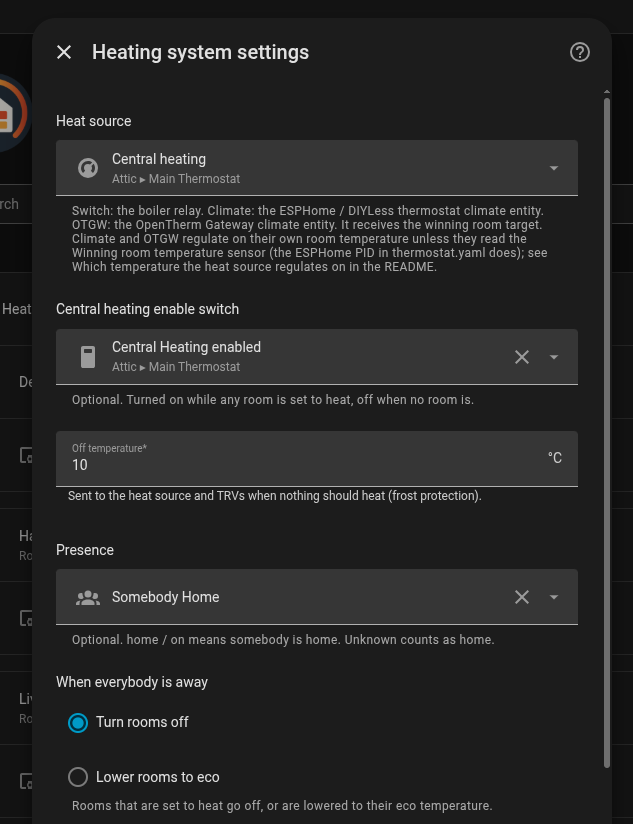
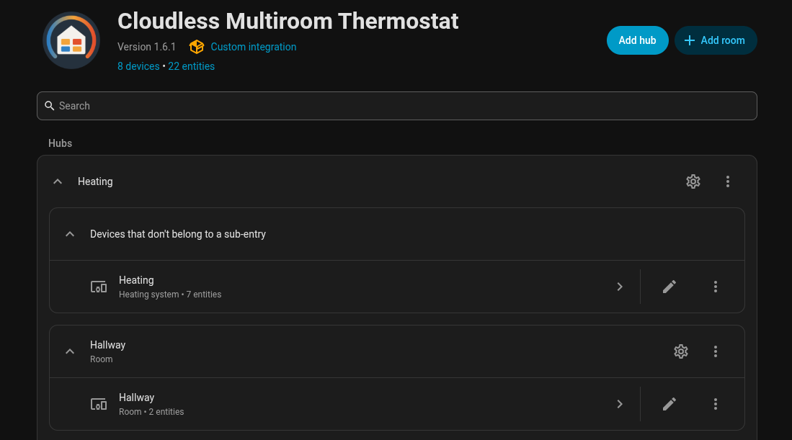

# Getting started

From nothing to a heating system with rooms on your dashboard. Every step can be changed later.

## What you need

- **Home Assistant 2026.10 or newer.**
- **A temperature sensor in every room.** Any sensor Home Assistant can see. TRVs are optional: a room without them still tells the boiler it needs heat.
- **A boiler controller you run yourself (recommended).** An OpenTherm controller without a room sensor of its own, running ESPHome with [`thermostat.yaml`](hardware.md#esphome-opentherm-thermostat-thermostatyaml). Two ready ways:
  - a [DIYLess OpenTherm thermostat](https://diyless.com/product/opentherm-thermostat) board, which this integration is built and tested on;
  - any OpenTherm adapter with an ESP32, with the same config and your own pins in `opentherm:`.

  A few euros, two wires to the boiler, no cloud and no account. This gives full multi-room control, and it is what the learning features and the PID advice are made for. It replaces the thermostat on your wall.
- **Also works:**
  - An **on/off relay**: full multi-room control, but the boiler only knows on and off, so no gentle low flow heating.
  - A **smart room thermostat** or an **OpenTherm Gateway** with its room thermostat: *target only*. The integration still runs every room's TRVs, but the boiler follows the room where that thermostat hangs. A cold bedroom can't start the boiler while that room is warm, and the PID advice has nothing to tune. [How it works](how-it-works.md) explains why.

[Hardware](hardware.md) has the details and the setup this was built on.

## Install

Search for **Cloudless Multiroom Thermostat** in the Marketplace (Home Assistant 2026.11 and newer) or HACS, install it and restart Home Assistant. Then **Settings > Devices & services > Add integration > Cloudless Multiroom Thermostat**. The dashboard card comes with it.

Not found? The catalog listing is still in review. Use the button, or add the repository by hand as below.

The first button opens the repository in your Home Assistant (the Marketplace on 2026.11 and newer, HACS on 2026.10), ready to install. After installing, the second button starts the setup.

**Home Assistant 2026.11 and newer (Marketplace):**

1. **Settings > Marketplace > Add from link**, enter `BarBaar44/Cloudless-Multiroom-Thermostat` and select **Add**. The Marketplace may ask you to connect GitHub first.
2. Open **Cloudless Multiroom Thermostat**, select **Install** and confirm. Restart Home Assistant if the Marketplace asks for it.
3. **Settings > Devices & services > Add integration > Cloudless Multiroom Thermostat**, if the setup didn't open by itself.

An install from HACS moves to the Marketplace by itself when you update Home Assistant to 2026.11, with the same entities.

**Home Assistant 2026.10 (HACS):**

1. In HACS: **⋮ > Custom repositories**, add `https://github.com/BarBaar44/Cloudless-Multiroom-Thermostat` with type **Integration**.
2. Install **Cloudless Multiroom Thermostat** and restart Home Assistant.
3. **Settings > Devices & services > Add integration > Cloudless Multiroom Thermostat**, or use the second button above.

## The heating system

One heating system has one heat source. Rooms are added to it afterwards. Setting it up takes three steps.

**1. Name and heat source type.**

| Type | Use it for | What it receives |
|---|---|---|
| **On/off switch** | A relay boiler | On when a room is the hysteresis below its target, off when every room reached its target |
| **Climate entity** | An ESPHome or DIYLess OpenTherm thermostat, or any thermostat with a setpoint | The target of the room that needs heat most |
| **OpenTherm Gateway (OTGW)** | The OTGW climate entity | The same target |

The Climate and OTGW types only send a *target*. For real multi-room control the thermostat must also regulate on the winning room's *temperature*, the integration's **Winning room temperature** sensor. The ESPHome PID in [`thermostat.yaml`](hardware.md#esphome-opentherm-thermostat-thermostatyaml) does. A thermostat that regulates on its own sensor heats for the spot where it hangs, whichever room won: see [How it works](how-it-works.md#which-heat-source-gives-full-multi-room-control).

**2. Heat source.**

| Setting | Default | What it does |
|---|---|---|
| Heat source | | The relay, thermostat or OTGW climate entity |
| Central heating enable switch | none | Optional. On while a room that drives the heat source is heating; off while none is (rooms off or paused, or only rooms that heat along) |
| Hysteresis | 0.3 °C | On/off switch only: start when a room is this far below its target, stop when it reaches it |

**3. Settings.**

| Setting | Default | What it does |
|---|---|---|
| Off temperature | 10 °C | Sent to the heat source and TRVs when nothing should heat (frost protection) |
| Presence | none | Optional. See [Away](away.md) |
| When everybody is away | Turn rooms off | Or lower rooms to eco. See [Away](away.md) |
| Skip unchanged TRV writes | on | Saves TRV batteries. When off, the heartbeat also resends every TRV target |
| Heartbeat | 60 min | How often room temperatures are resent to TRV external inputs, even when unchanged |

All of these can be changed later under **Configure** on the heating system. The same page switches on the optional [learning features](experimental.md).

## Your first room

On the integration page, select **Add room**. Two steps: name and temperatures first, then the sensor, TRVs and windows. [Rooms](rooms.md) explains every field; for a first room only the name and the temperature sensor matter.

Add as many rooms as you like; the gear next to a room edits it.

## Check that it works

1. Add the [Heating Control Card](card.md) to a dashboard (reload the browser once after installing).
2. Set a room to **Heat** with a target above its temperature. It shows as the winner, and the heat source gets its target (or switches on, with an on/off switch).
3. Set the target below the temperature. The room shows as reached and the heat source gets the off temperature.

Nothing happens? See [Troubleshooting](troubleshooting.md).

## What next

- **Scheduling** is left to you for now: an automation or a scheduler card that sets presets or temperatures on the room climates. Schedules in the integration are planned for v2.0, see the [roadmap](../ROADMAP.md).
- [Away](away.md) and [Windows](windows.md), if you set a presence entity or window sensors.
- [Learning features](experimental.md), to see how your house heats.
