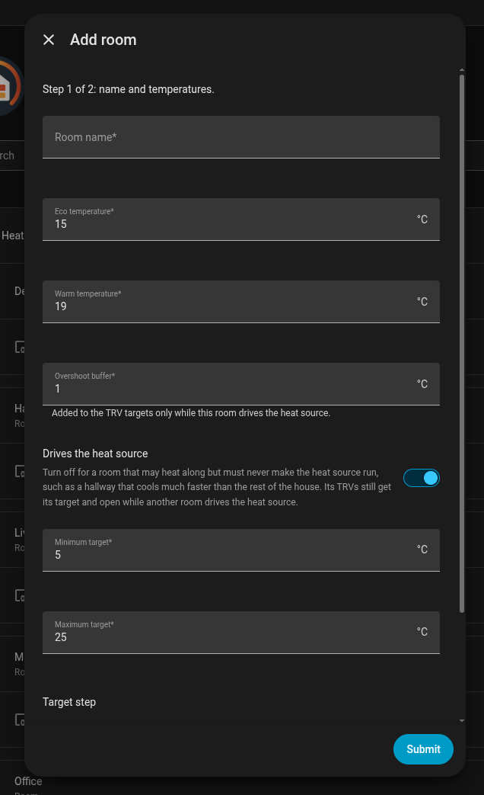

# Rooms

**In one sentence:** every room is a virtual thermostat with its own sensor, target and valves, and the room that needs heat most drives the boiler.

## When you want it

Always: rooms are the core of the integration. Add every room you want to heat, also rooms without TRVs (they only add heat demand) and rooms that should only heat along (a hallway).

## How to add one

On the integration page, **Add room**. Two steps:

1. **Name and temperatures.**
2. **Sensors and valves** for that room.

The gear next to a room edits it, with the same two steps. To put a room in an area, set the area on the room's device page.

## Settings

**Step 1: name and temperatures**

| Setting | Default | What it does |
|---|---|---|
| Room name | | Also the name of the room's climate entity and device. Must be unique |
| Eco temperature | 15 °C | The target of the **Eco** preset, and the away temperature when away lowers rooms to eco |
| Warm temperature | 19 °C | The target of the **Warm** preset |
| Overshoot buffer | 1.0 °C | Added to the TRV targets only while this room drives the heat source. See [The overshoot buffer](how-it-works.md#the-overshoot-buffer) |
| Drives the heat source | on | Off for a room that may heat along but must never make the heat source run. See below |
| Minimum target | 5 °C | Lowest target you can set |
| Maximum target | 25 °C | Highest target you can set |
| Target step | 0.5 °C | Step of the target in the UI and on the card |

**Step 2: sensors and valves**

| Setting | Default | What it does |
|---|---|---|
| Room temperature sensor | | The room's temperature. Everything in the room works from this number |
| Radiator valves (TRVs) | none | Optional. A room without TRVs only adds heat demand |
| TRV external temperature inputs | none | Optional. Number entities that receive the room temperature, for example on a Sonoff TRVZB or Shelly BLU TRV |
| Window and door sensors | none | Optional. See [Windows](windows.md) |
| Window open delay | 120 s | See [Windows](windows.md) |
| Window close delay | 60 s | See [Windows](windows.md) |

### Presets

Every room has two presets, **Eco** and **Warm**, with the temperatures above. Setting a temperature yourself switches the preset to **Manual**. Mode, preset and target survive a restart.

### Drives the heat source

Turn it off for a room that may be heated but must never make the heat source run, such as a hallway that cools much faster than the rest of the house and would otherwise keep winning. Such a room:

- never becomes the winner, never starts an on/off heat source and doesn't turn on the central heating enable switch;
- still gets its target on its TRVs, so it heats along whenever another room drives the heat source;
- shows as **waiting** while it is below target and nothing else needs heat.

### TRV external temperature inputs

A TRV's own sensor sits on the radiator and reads warm. The integration sends the room sensor's reading to the TRVs' external temperature inputs, so the room, the winner choice and the TRV all work from the same number. It resends the value every heartbeat (heating system settings, 60 minutes by default), because some TRVs, like the Sonoff TRVZB, fall back to their own sensor after 2 hours without an update.

## What you see on the card

Each room shows its temperature, target, Heat/Off and its **role**:

| Role | Meaning |
|---|---|
| `winner` | This room drives the heat source |
| `passenger` | Below target and heating along while another room drives the heat source |
| `calls_for_heat` | Below target, but the heat source isn't running yet (with an on/off switch: less than the hysteresis below target) |
| `waiting` | Below target, but it doesn't drive the heat source and nothing else needs heat |
| `reached` | At or above its target |
| `paused` | Set to heat but held off by a window, a manual pause or away |
| `off` | Set to Off |

The same role is the `role` attribute of the room's climate entity. [Reference](reference.md#per-room) lists all attributes.

## Common questions

**Why does my hallway keep winning?** It cools faster than the rest of the house, so its gap is often the biggest. Turn off **Drives the heat source** for it.

**Can a room have no TRVs?** Yes. It then only adds heat demand: it can win and make the boiler run, and its radiators heat as far as their own valves allow.

**How do I hold a room off without changing its target?** The `pause_room` service holds it off until `resume_room`, keeping its mode and target. See [Reference](reference.md#services).

**Does renaming a room lose anything?** No. Rooms are matched by an internal id, also in the learning features.

**How do I schedule a room?** For now with an automation or a scheduler card that sets presets or temperatures on the room climates. Schedules in the integration are planned for v2.0, see the [roadmap](../ROADMAP.md).
