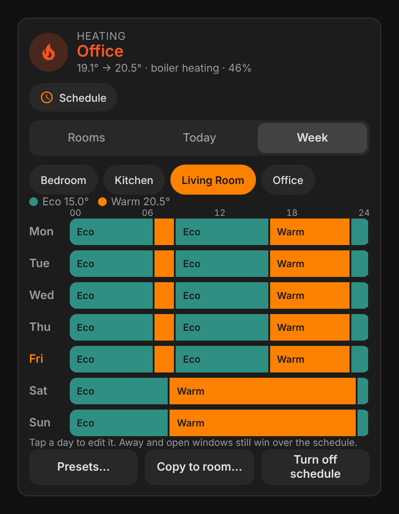

# Schedules

**In one sentence:** every room follows its own week schedule of presets, run by the integration itself, so the heating keeps to it with no dashboard or automation open.

## When you want it

Always: from v2.0 every room has a schedule, or you turn scheduling off for a room you control yourself. A room with neither holds the **Temperature without schedule** (15 °C) until you choose.

## How to turn it on

- **New rooms:** the last step of **Add room** asks how the room starts: one preset all day (Eco by default), or scheduling off.
- **Rooms you already had:** they have no schedule after the upgrade and hold 15 °C. **Settings > Repairs** lists them. Give each one a schedule with **Make schedule** in the [Heating Control Card](card.md#schedules) or the `set_schedule` action, or turn scheduling off for it. [Upgrading to v2.0](upgrade-v2.md) walks through it.

<p align="center"></p>

## Settings

| Setting | Where | Default | What it does |
|---|---|---|---|
| Temperature without schedule | Heating system settings | 15 °C | Held by a room without a schedule, and by every room with a schedule while schedules are suspended |

A schedule is a week, Monday first. Each day has up to 12 switch points on 15 minute steps; each sets a preset (Eco, Warm, or Off) and holds until the next one, also over midnight and over days without points.

## How a room behaves

| The room | What it does |
|---|---|
| Has a schedule | Follows it. A target or preset set by hand lasts until the next schedule change (the next switch point to another preset; with one preset all day, until midnight) |
| Has no schedule | Holds the Temperature without schedule. Setting a target or preset is refused with "has no schedule: make one or turn scheduling off" |
| Scheduling off | Yours: presets, targets and your own automations work as before v2, nothing expires |
| Schedules suspended | Rooms with a schedule hold the Temperature without schedule; rooms with scheduling off are not affected. A change by hand starts that one room's schedule again, with the change on top, until schedules are resumed |

## Presets

Eco and Warm are built in; add your own (Sleep, for example), up to 10 in all. Each room has its own temperature per preset, or *not used*: a switch point to a preset the room doesn't use means **Off** for that room. Eco and Warm always have a temperature (the room form edits the same two values). A preset still used in a schedule can't be removed. Each preset can have a colour, used for it everywhere on the card. The card's presets dialog uses the `set_presets` action:

```yaml
action: cloudless_multiroom_thermostat.set_presets
data:
  presets:
    - {id: eco, name: Eco}
    - {id: warm, name: Warm, color: "#ff5722"}
    - {name: Sleep, color: "#5c6bc0"}   # new: gets the id sleep
  temperatures:
    climate.living_room: {sleep: 16.5}
    climate.office: {sleep: null}       # not used here
```

## Changes by hand

A change by hand on a room with a schedule lasts until the next schedule change, unless you choose otherwise with the `set_override` action (the card's *Keep this until* dialog uses it):

| Keep this until | Ends |
|---|---|
| Next schedule change (default) | At the next switch point to another preset |
| For a time (1 or 3 hours in the card, up to 7 days) | After that time |
| Until I change it | Only with Back to schedule: the schedule is skipped for this room until then |

**When everyone leaves, changes by hand end,** straight away, also "until I change it". Coming home gives what the schedule says. Tick **Keep when everyone is away** for a change that must stay, for example for a visitor Home Assistant doesn't track: it then ranks above away for that room. An open window and a pause still win.

**Off is off:** a room switched off stays off whatever its schedule says. Switch it back to heat and it does what the schedule says at that moment. A switch point to **Off** is different: the room stays on heat and holds the off temperature until the next point.

Away, windows and pauses work on top of the schedule, as before. The schedule keeps running underneath, so coming home or closing a window gives what the schedule says now.

## Common questions

**Why does my room say it has no schedule?** It was there before v2.0, or the schedule file could not be read (Repairs then says why). Make a schedule, or turn scheduling off for it.

**My automation stopped changing a room.** It sets a target on a room without a schedule; the automation trace shows the error. Give the room a schedule (the automation's change then lasts until the next schedule change) or turn scheduling off for it.

**What happens on daylight saving days?** Switch points are in local time. A point in the hour that is skipped in spring happens at the jump; a point in the hour that repeats in autumn happens once.

## Actions

| Action | Target | Fields |
|---|---|---|
| `cloudless_multiroom_thermostat.set_schedule` | a room climate | `week`: seven lists of `{time, preset}`, Monday first. `scheduling`: `on` (default) or `off`. Without `week`, turning on uses the schedule the room already had |
| `cloudless_multiroom_thermostat.set_override` | a room climate | A change by hand: `temperature` or `preset`; `until` (`next_change`, default, or `permanent`) or `duration`; `keep_when_away` (default off) |
| `cloudless_multiroom_thermostat.resume_schedule` | a room climate | Ends a change by hand: back to the schedule |
| `cloudless_multiroom_thermostat.set_presets` | optional heating system | `presets`: the whole list (`id`, `name`, `color`; no id is new); `temperatures`: per room climate `{preset: value or null}`. See [Presets](#presets) |
| `cloudless_multiroom_thermostat.suspend_schedules` | optional heating system | Every room with a schedule holds the Temperature without schedule; a change by hand starts that room's schedule again |
| `cloudless_multiroom_thermostat.resume_schedules` | optional heating system | Rooms follow their schedules again |

Example, Warm from 07:00 to 22:00 every day:

```yaml
action: cloudless_multiroom_thermostat.set_schedule
target:
  entity_id: climate.living_room
data:
  week:
    - [{time: "07:00", preset: warm}, {time: "22:00", preset: eco}]
    - [{time: "07:00", preset: warm}, {time: "22:00", preset: eco}]
    - [{time: "07:00", preset: warm}, {time: "22:00", preset: eco}]
    - [{time: "07:00", preset: warm}, {time: "22:00", preset: eco}]
    - [{time: "07:00", preset: warm}, {time: "22:00", preset: eco}]
    - [{time: "07:00", preset: warm}, {time: "22:00", preset: eco}]
    - [{time: "07:00", preset: warm}, {time: "22:00", preset: eco}]
```

## Technical detail

Room climate attributes: `schedule_state` (`active`, `none`, `off`, `suspended`, `blocked`), `next_change` (`at`, local time, and `preset`), `override` (`target`, `preset`, `until` or none for until I change it, `keep_when_away`), `override_until`, `presets` (the system's presets in order, each with `id`, `name`, `color` and this room's `temperature`, none for not used). Schedules, preset temperatures and overrides are kept in `.storage/cloudless_multiroom_thermostat.schedule.<entry_id>`, versioned: a copy `<file>.v<N>.bak` is made before every migration, and a file written by a newer version is never overwritten (`blocked`: every room holds the Temperature without schedule, Repairs says why).
