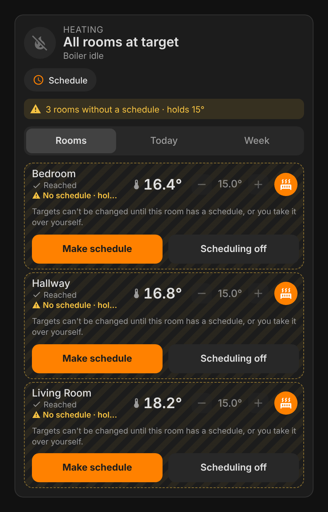

# Upgrading to v2.0

**In one sentence:** v2.0 runs a week schedule per room inside the integration, and every room you already had starts without one, so it holds 15 °C until you give it a schedule or turn scheduling off for it.

Read this page before you install v2.0. The upgrade takes about ten minutes for a few rooms, most of it making schedules in the card.

## Behaviour change: every room needs a schedule

After the upgrade **every room holds 15 °C** (the new setting **Temperature without schedule**) until you choose one of two things for it:

- **Make schedule:** the room follows its own week of presets (Eco, Warm, Off and presets of your own). It starts with Warm from 07:00 to 22:00 and Eco the rest of the day, every day.
- **Scheduling off:** the room is yours, as in v1: presets, targets and your own automations work as before and nothing expires.

A room on Warm 20.5 °C goes to 15 °C at the first start of v2.0. That is on purpose: the heating never guesses a schedule for you. **Settings > Repairs** lists the rooms without a schedule, and the card shows each one hatched with **Make schedule** and **Scheduling off**.

While a room has no schedule, `climate.set_temperature` and `climate.set_preset_mode` on it are refused with *<room> has no schedule: make one or turn scheduling off*. Switching it off and on still works; on heat it holds 15 °C.

## Before you upgrade

1. **Make a Home Assistant backup** (**Settings > System > Backups**). Going back to v1.9.2 is only clean from a backup: v2.0 moves each room's Eco and Warm temperatures into the new schedule file, and v1.9.2 doesn't read that file.
2. **List the automations that change your rooms**: a heating schedule, a sun assist automation, anything that sets a target or preset on a room climate. Each one either goes (the integration does it now) or keeps working on a room with scheduling off. See [Your automations](#your-automations).
3. **Pick a quiet moment.** Until you have made the schedules, rooms hold 15 °C.

## Upgrade

1. **Install the update** under **Settings > Updates**, restart Home Assistant, then reload the browser once so dashboards load Heating Control Card 2.0.
2. **Open the card.** Every room says **No schedule · holds 15°**.
3. **For each room, tap Make schedule or Scheduling off.** Make schedule starts with Warm from 07:00 to 22:00 and Eco the rest of the day, every day: **Save schedule**, and the room follows it. A card that lists only some rooms (`thermostats`): tap **N rooms without a schedule** in the header for all of them. Shape the week later in the **Week** view: drag switch points on a tablet or desktop, a list of times on a phone, **Copy day to…** and **Copy to room…** to repeat it. See [Schedules](schedules.md) and [the card](card.md#schedules).
4. **Check Settings > Repairs.** *Rooms without a schedule* goes once every room has a schedule or scheduling off.
5. **Check Configure > Features** on the heating system. Features you used in v1 (presence and away, windows, learning features) are on, with their settings kept. Switch on what you want from the new ones: **Guest mode** and **Sun assist**.
6. **Turn off the automations** that the integration replaces (below).

Prefer YAML? `set_schedule` sets a whole week, or scheduling off, in one call. [Schedules](schedules.md#actions) has an example.

## Your automations

| Your automation | In v2.0 |
|---|---|
| A heating schedule (Warm at 07:00, Eco at 22:00) | Make it the room's schedule and turn the automation off. Left on, its change on a scheduled room lasts until the next switch point |
| A sun assist automation | Turn it off and switch on [Sun assist](sun-assist.md): same idea, with a forecast check and one check on the room temperature |
| Sets a target or preset now and then (a button, a scene, a voice command) | Works on a room with a schedule: the change lasts until the next schedule change. Use `set_override` to make it last longer, or for a set time |
| Runs a room all by itself | Turn scheduling off for that room. It then works exactly as in v1 |
| Sets targets on a room without a schedule | Refused with an error in the automation trace until the room has a schedule or scheduling off |

## Everything that changes

### Rooms and schedules

- **A change by hand ends at the next schedule change** on a room with a schedule (the next switch point to another preset; with one preset all day, at midnight). In v1 it stayed until you changed it. Tap the target in the card for **Keep this until**: 1 hour, 3 hours or until I change it, or use `set_override`.
- **A preset set by hand** on a room with a schedule is a change by hand too: it lasts until the next switch point.
- **Off is off.** A room switched off stays off whatever its schedule says; switched back to heat, it does what the schedule says at that moment. A switch point *to* Off is different: the room stays on heat and holds the off temperature.
- **Presets of your own.** Eco and Warm are built in; add up to 8 more (Sleep, for example), each with a temperature per room or *not used* (a switch point to it means Off in that room), and a colour. The room form still edits Eco and Warm: same values, one place.
- **Add room** has a third step: how the new room starts (Warm from 07:00 to 22:00 and Eco the rest of the day, every day, or scheduling off).
- **Suspend schedules** (the **Schedule** pill in the card, or `suspend_schedules`): every room with a schedule holds the Temperature without schedule until you resume. A change by hand on one room starts that room's schedule again; the others stay suspended.

### Away

- **Changes by hand end when everyone leaves,** straight away, also "until I change it". Coming home gives what the schedule says. Tick **Keep when everyone is away** for a change that must stay.
- **When everybody is away** (off, or lower rooms to eco) works as in v1, on top of the schedule.
- **Guest mode** (new feature): the house counts as occupied whatever presence says, until you turn it off or until a set time. For visitors Home Assistant doesn't track. See [Guest mode](away.md#guest-mode).

### Settings and entities

- **Configure is a menu:** System settings, Features, and a page per feature that is on. A feature that is off has no settings page, no entities and no section in the card; its settings are kept for when you switch it on again.
- **New setting** under System settings: **Temperature without schedule** (15 °C).
- **New actions:** `set_schedule`, `resume_schedule`, `set_override`, `set_presets`, `suspend_schedules`, `resume_schedules`, `set_guest_mode`.
- **New room attributes:** `schedule_state`, `schedule`, `schedules_suspended`, `presets`, `next_change`, `override`, `override_until`, `sun_assist`. See [Reference](reference.md).
- **New switch:** **Someone is home (guest mode)**, when Guest mode is on.
- **New Repairs issues:** rooms without a schedule, and a schedule file written by a newer version (scheduling then stops and every room holds the Temperature without schedule, so a downgrade never breaks the file).

### The card

Heating Control Card 2.0 comes with the integration. Each row gets a schedule line and a strip for today; new **Today** and **Week** views, the schedule editor, a presets dialog and header pills for suspend and guest mode. Two new colour keys: `accent` and `override`. Your card YAML keeps working. See [Heating Control Card](card.md).

### Learning features

- **Wording only:** *Progress to stable* is now **Learning progress**, and the stages are **Learning**, **Checking** and **Proven** instead of alpha, beta and stable. Nothing changes in what they do.
- **The evening report stays in v2.0.** The 21:00 report, its sensor, the Evening notification option and `experimental_report` go in v2.1.0, replaced by live sensors and a learning view in the card. Home Assistant's log says so once per start. Don't build new dashboards or automations on the report.

### What doesn't change

The winner, the two tiers, TRVs, windows, pauses, the heat source and `thermostat.yaml`: no reflash needed. The learning data in `config/cloudless_multiroom_thermostat/` is kept.

## Common questions

**Can I upgrade without schedules?** Yes: tap **Scheduling off** on every room and the heating works as in v1.9.2. You can make schedules later.

**Can I get rid of the 15 °C?** Change **Temperature without schedule** under **Configure > System settings**. It is also what rooms hold while schedules are suspended.

**Where are the schedules kept?** In `.storage/cloudless_multiroom_thermostat.schedule.<entry_id>`, so editing a schedule never reloads the integration. A Home Assistant backup includes it.

**How do I go back to v1.9.2?** Restore the backup you made before the upgrade. Installing v1.9.2 over v2.0 without it brings every room's Eco and Warm back to their defaults.
